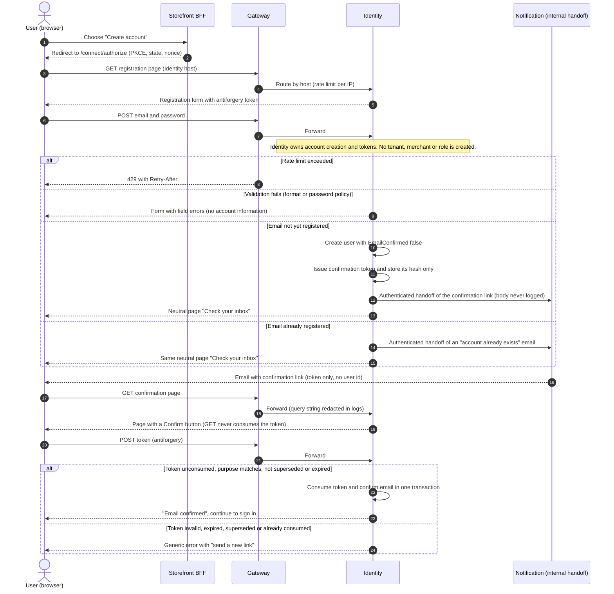
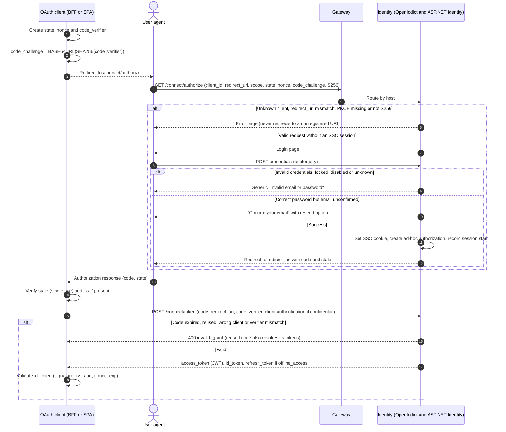
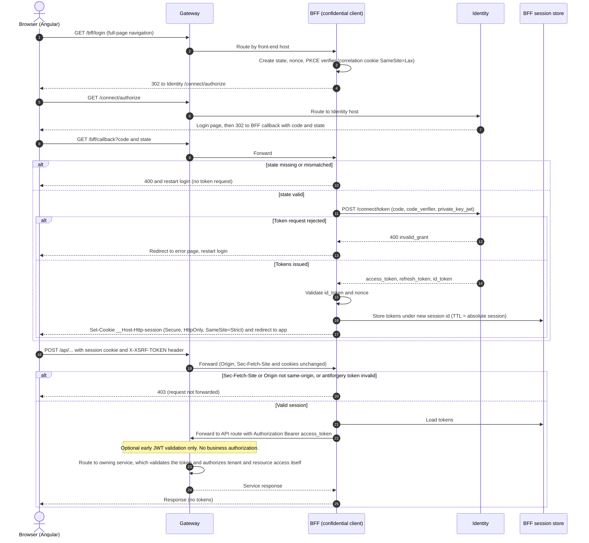
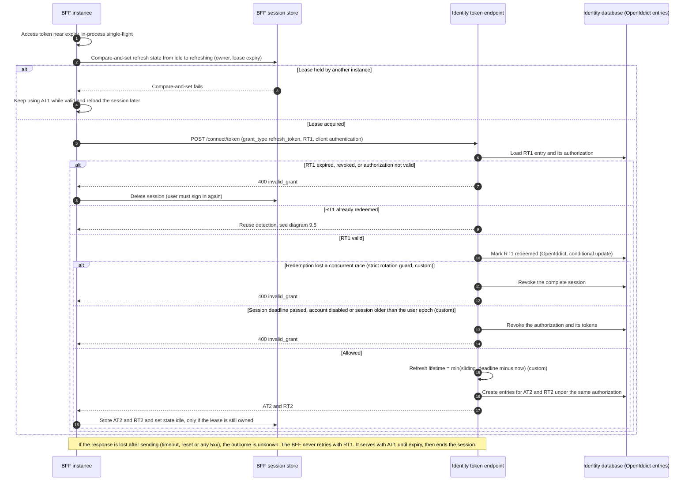
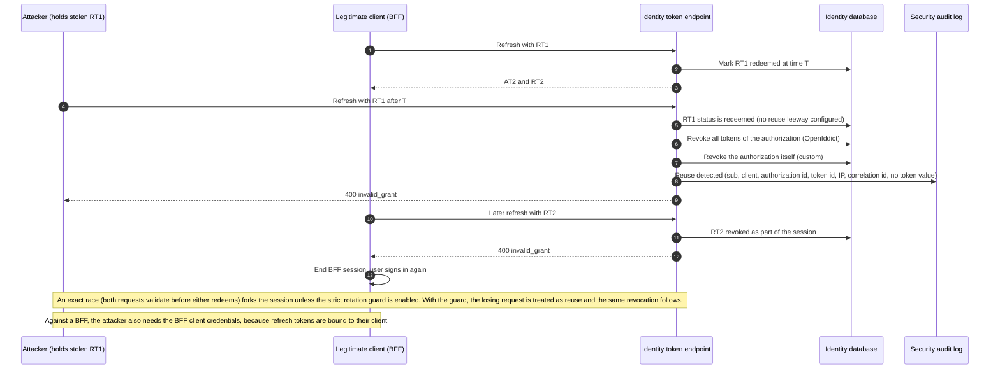
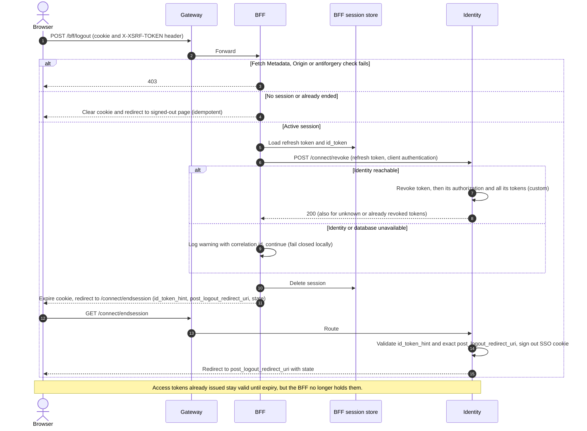
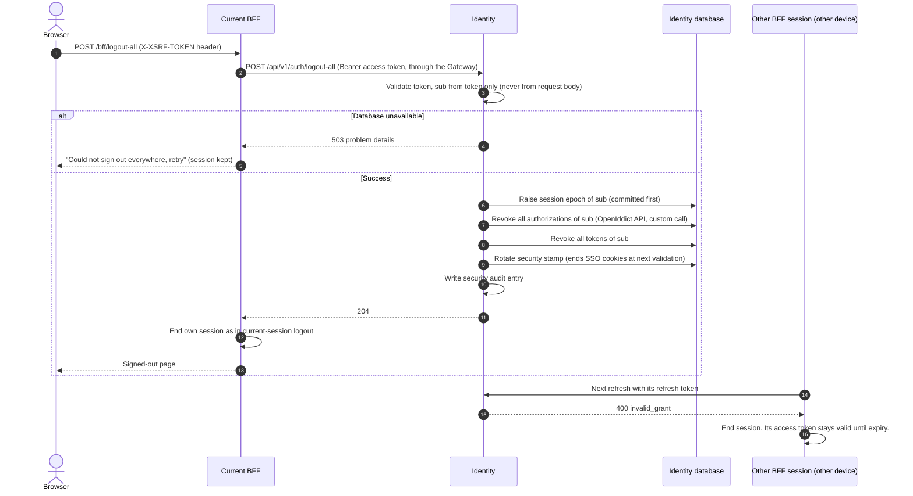
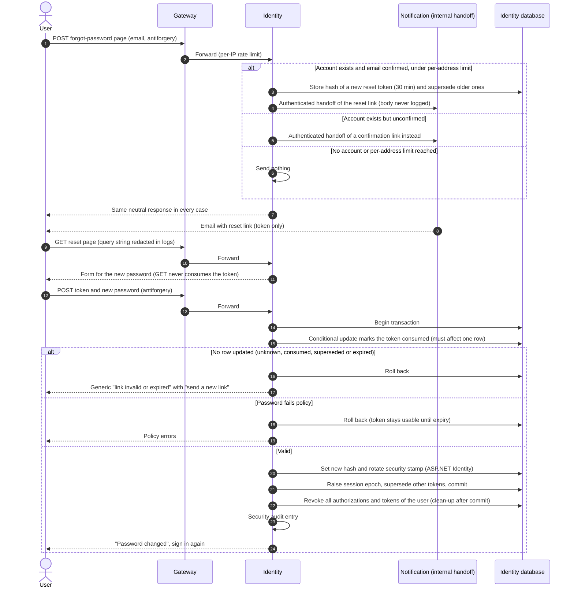
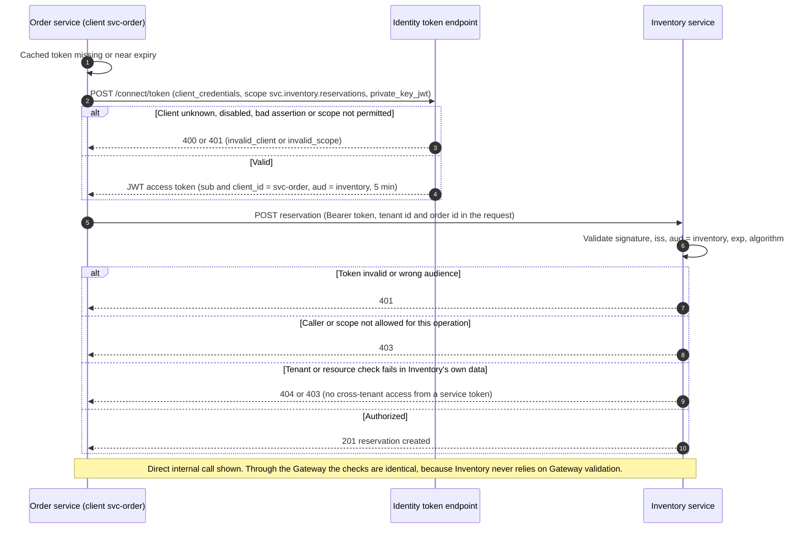

# Phase 2.2: Authentication Flows and Security Design

- **Status:** **Accepted (revision 3).** The owner approved the decisions on 2026-11-18. They are recorded in [ADR-016](../decisions/ADR-016-browser-client-architecture-backend-for-frontend.md), [ADR-017](../decisions/ADR-017-token-session-and-protocol-strategy.md) and [ADR-018](../decisions/ADR-018-account-security-tokens-and-security-email-delivery.md). **The ADRs are the decision source.** Sections 1 to 10 keep the revision 2 analysis as rationale. Where they say "Recommended", "Proposal" or "Open", read [section 11](#11-decisions-and-implementation-plan) and the ADRs for the outcome.
- **Phase:** 2.2 (authentication flows, browser client architecture, token and session strategy). Design only.
- **Date:** 2026-11-18. **Revision 2** (same day) applies the architectural review corrections summarized in [Architectural Review Corrections](#architectural-review-corrections). **Revision 3** (same day) records the owner decisions and the proof-of-concept evidence ([Revision 3: owner decisions](#revision-3-owner-decisions)).
- **Builds on:** [ADR-015](../decisions/ADR-015-identity-provider-aspnet-core-identity-and-openiddict.md) (accepted), [PHASE_2_IDENTITY_DESIGN_BRIEF.md](PHASE_2_IDENTITY_DESIGN_BRIEF.md), [IDENTITY_API_CONTRACT.md](../api/IDENTITY_API_CONTRACT.md), [ADR-007](../decisions/ADR-007-yarp-api-gateway.md), [ADR-014](../decisions/ADR-014-logical-tenant-isolation.md), [ADR-006](../decisions/ADR-006-redis-usage-boundaries.md), [PROJECT_DECISIONS.md](PROJECT_DECISIONS.md).
- **Implementation:** Phase 2.3, authorized. This document creates no code. The implementation follows the ADRs and the test plan in [section 11.5](#115-required-implementation-tests).

## How to read this document

Decision tiers, as in ADR-015:

| Marker | Meaning |
|---|---|
| **Accepted** | Already decided by an accepted ADR. Restated only by reference. |
| **Recommended** | The proposed direction of revision 2. The binding outcome is in [section 11.1](#111-decision-outcomes) and the ADRs. |
| **Open** | Needed a decision in revision 2. Every item now has an outcome in [section 11](#11-decisions-and-implementation-plan). |
| **Proposal** | A concrete value or data field suggested for review (for example a lifetime or a column). Not a decision. |

Responsibility markers, used wherever behaviour is described:

| Marker | Meaning |
|---|---|
| **[OpenIddict]** | Native OpenIddict behaviour, verified against the version baseline below. |
| **[ASP.NET Identity]** | Native ASP.NET Core Identity behaviour, verified against .NET 10 (`release/10.0`). |
| **[Custom]** | EnterpriseCommerce application logic that must be designed and built. |
| **[Protocol]** | A requirement of an RFC or OpenID specification, independent of the framework. |

**Version baseline.**

- **OpenIddict 7.9.0** (latest stable, released 2026-11-14, targets .NET 8, 9, 10 and 11), packages `OpenIddict.AspNetCore` and `OpenIddict.EntityFrameworkCore`. Source claims are verified against the Git tag `7.9.0`. OpenIddict 8.0 exists only as a preview and is out of scope.
- **ASP.NET Core Identity 10.0.15**, the servicing release already pinned for the other `Microsoft.AspNetCore.*` packages in `Directory.Packages.props`: `Microsoft.AspNetCore.Identity.EntityFrameworkCore`, `Microsoft.Extensions.Identity.Core` and `Microsoft.Extensions.Identity.Stores`. Source claims are verified against the Git tag `v10.0.15` where stated, otherwise against the `release/10.0` branch.
- Behaviour seen only on a development branch is never treated as guaranteed. [Section 3.6](#36-verification-level-per-claim) gives the verification level of every claim. Everything is re-checked when the implementation phase pins the packages.

## Table of contents

- [Architectural Review Corrections](#architectural-review-corrections) (revision 2)
- [Revision 3: owner decisions](#revision-3-owner-decisions)

1. [Scope, accepted decisions and non-goals](#1-scope-accepted-decisions-and-non-goals)
2. [Document consistency findings](#2-document-consistency-findings)
3. [Verified framework behaviour](#3-verified-framework-behaviour)
4. [Browser client architecture](#4-browser-client-architecture)
5. [Authentication flows](#5-authentication-flows)
6. [Token security](#6-token-security)
7. [Session management](#7-session-management)
8. [Endpoint mapping proposal](#8-endpoint-mapping-proposal)
9. [Sequence diagrams](#9-sequence-diagrams)
10. [Failure and threat matrix](#10-failure-and-threat-matrix)
11. [Decisions and implementation plan](#11-decisions-and-implementation-plan)
12. [Sources](#12-sources)

---

## Architectural Review Corrections

Revision 2 applies the corrections requested in the architectural review of revision 1. **Nothing became accepted.** Every recommendation is still a proposal for review.

| # | Area | Revision 1 | Revision 2 | Why |
|---|---|---|---|---|
| C1 | Refresh token reuse leeway | 10-second global leeway | **No leeway** (`null`). Refresh is single-flight per session across BFF instances. An optional strict rotation guard in Identity handles exact races. Uncertain refresh outcomes are never retried ([5.4](#54-refresh-token-lifecycle)). | A leeway issues valid sibling tokens (V7). No leeway alone is not enough either: exactly simultaneous requests both succeed (V41), and a lost response ends the session. |
| C2 | Complete session revocation | The authorization is revoked on reuse | Defines the **EnterpriseCommerce session**: authorization, tokens, BFF session, plus a proposed per-user session epoch. Defines how each part is revoked ([5.4.6](#546-revoking-the-complete-session)). | Natively, reuse revokes tokens only (V5). |
| C3 | BFF cookies and CSRF | A custom header was the main CSRF control | Layered defense: `SameSite=Strict`, Fetch Metadata with an exact `Origin` fallback, a session-bound antiforgery token in a request header, no CORS, HTTPS only. Separate rules for cookies during OAuth redirects. Prefix support and its limits are documented ([4.6](#46-cookies-csrf-and-https)). | A custom header must not be the only defense. RFC 10017 does not cover `Origin` checks. `__Host-Http-` is defined only in an Internet-Draft and is not enforced by Safari. |
| C4 | Credential entry | Handled as an endpoint-mapping change | Separates OAuth login, the Identity-hosted login UI, registration, password change and password reset. Proposes an Identity-hosted account UI, and a **clarification of the scope of ADR-015 R1** as decision D27. ADR-015 is unchanged ([5.8](#58-credential-entry-and-the-identity-hosted-account-ui)). | The tension (F3) must be resolved by a decision, not by editing documents. |
| C5 | Confirmation and reset tokens | Option B: framework tokens plus a stamp rotation | **Option A:** persisted, hashed, single-use tokens, consumed atomically with the account change. Separates the security stamp, Data Protection tokens, persisted tokens, JWT revocation and session revocation ([5.6.3](#563-email-confirmation-and-password-reset-tokens)). | Framework tokens are single-use under concurrent replay only through the EF Core concurrency stamp, and only when the change is made in one update. A stamp rotation in a separate update leaves a replay window (V46). Option A states the guarantee directly. |
| C6 | Security email delivery | Identity sends credential emails itself | **Notification keeps email delivery.** The link reaches it through an authenticated synchronous handoff, never in a Kafka payload. An opaque-reference handoff is the target once the event flow exists ([5.6.4](#564-delivery-of-security-emails)). | Revision 1 changed service ownership, which needs approval. |
| C7 | BFF topology | One BFF per front end | Separates security boundaries (always one per front end) from deployment options. Compares one codebase deployed three times, three codebases, and one shared process. Recommends one codebase deployed three times ([4.5](#45-bff-topology-security-boundaries-versus-deployment-boundaries)). | Isolation must not depend on how many projects exist. |
| C8 | Verification | Mixed tag, branch and documentation sources | Every framework claim was re-checked against the tags `7.9.0` and `v10.0.15`, or is marked with its actual level and package version ([3.6](#36-verification-level-per-claim)). New facts V41 to V46. U1 partly resolved. | Development branches do not guarantee stable-package behaviour. |

Also updated:

- **Diagrams:** 9.1 and 9.3 to 9.8.
- **Threat matrix:** rows T6, T7 and T11 changed. Rows T21 to T23 added.
- **Decisions:** D3, D5, D9, D10, D11 and D15 revised. D22 to D27 added.
- **Consistency findings:** F2, F3 and F6 now point to these resolutions.

## Revision 3: owner decisions

The owner reviewed revision 2 and the proof-of-concept (PoC) evidence and approved the decisions on 2026-11-18. Every D-item now has an outcome ([section 11.1](#111-decision-outcomes)). Where the approved model differs from revision 2, the ADR wins. Read the body of this document with these substitutions:

| Revision 2 term or proposal | Accepted outcome | Record |
|---|---|---|
| Per-user **session epoch** (a timestamp, D25) | Per-user **security version**: a counter in a dedicated record, checked on Identity cookie validation, authorization, code exchange and refresh. A missing record fails closed. | ADR-017 section 7 |
| Optional **strict rotation guard** (D24) | **Mandatory refresh-token redemption ledger**: a unique row per redeemed refresh token entry, inserted before native redemption | ADR-017 section 5 |
| Admin-console reuse scope: open (D24) | Admin-console reuse raises the security version and invalidates **all** of the user's sessions. Other clients revoke only the affected authorization. | ADR-017 section 5 |
| Reuse detection triggered by any presenter | **Presenter check first:** a token presented by a different client is rejected with no revocation (PoC-13e, threat [T24](#10-failure-and-threat-matrix)) | ADR-017 section 5 |
| Epoch raised "in its own committed transaction", revocation afterwards (D9) | **One short authoritative transaction** (account change, token consumption, security version, single authorization state). Whole-transaction retry on deadlock 1205. OpenIddict bulk revocation as idempotent post-commit cleanup (PoC-13d, threat [T25](#10-failure-and-threat-matrix)). | ADR-017 section 8 |
| E2 synchronous handoff from the request (D11) | A **bounded in-process queue** in Identity, whose worker performs the authenticated handoff to Notification, with status-only reconciliation | ADR-018 section 3 |
| Audiences "from the requested scopes" | **One audience per front-end client** for user tokens (Option B). Per-service audiences for service tokens only. Per-service user audiences deferred. | ADR-017 section 3 |
| Development client secrets for BFFs | `private_key_jwt` in deployed environments. Development may use non-committed development credentials. | ADR-016 section 2 |

---

## 1. Scope, accepted decisions and non-goals

### 1.1 Scope

This document designs:

- the browser client architecture for the storefront, the merchant portal and the admin console
- registration, login, the authorization code flow with PKCE, the refresh token lifecycle, logout, and password and account security flows
- service-to-service authentication
- token and session security, including key rotation
- failure and threat handling

It answers, or prepares the decision for, ADR-015 open questions O1, O2, O3, O4, O5, O6, O7, O8, O9, O11 and O12. O10 (the Identity domain model) and O13 (Identity integration events) are touched only where a flow depends on them.

### 1.2 Accepted decisions this document builds on

These are **Accepted** in [ADR-015](../decisions/ADR-015-identity-provider-aspnet-core-identity-and-openiddict.md) section 1 and are not reopened here:

- **A1:** Identity is the OAuth 2.0 / OpenID Connect authorization server, built with OpenIddict and ASP.NET Core Identity, persisted in Identity's SQL Server database.
- **A2:** marketplace authorization is never delegated to OpenIddict. Admin owns platform roles, Tenant & Merchant owns memberships and merchant roles, and every service authorizes its own resources.
- **A3:** ASP.NET Core Identity roles are not authoritative.
- **A4:** the Resource Owner Password Credentials grant and the implicit flow are rejected.
- **A5:** claims are never authorization proof, and the Gateway never replaces service-level validation and authorization.
- **A6:** framework types stay in Identity.Infrastructure and Identity.Api.
- **A7:** OpenIddict entities refer to users only through `sub`.
- **A8:** passwords, tokens, codes and secrets are never logged, and keys are never committed.

Also accepted elsewhere: logical tenant isolation ([ADR-014](../decisions/ADR-014-logical-tenant-isolation.md)), Redis for ephemeral data only ([ADR-006](../decisions/ADR-006-redis-usage-boundaries.md)), the Gateway as the single external entry point with no business logic ([ADR-007](../decisions/ADR-007-yarp-api-gateway.md)), and no sensitive data in integration events ([PROJECT_DECISIONS.md section 9](PROJECT_DECISIONS.md#9-messaging-and-integration)).

### 1.3 Non-goals

- MFA enrolment and MFA flows (designed later; this document only reserves the extension points).
- External logins (social providers).
- DPoP (evaluated in [section 6.6](#66-sender-constrained-tokens), not designed).
- The detailed Identity data model, database schema and migrations.
- The final Identity API contract. [Section 8](#8-endpoint-mapping-proposal) proposes the mapping. The contract is updated only after approval.
- Any implementation.

---

## 2. Document consistency findings

The mandatory documents were read in order. No contradiction prevents safe design work. The following inconsistencies and tensions were found. Each is recorded here and **not** silently resolved.

| # | Documents and sections | Finding | Impact | Proposed resolution |
|---|---|---|---|---|
| F1 | [IDENTITY_API_CONTRACT.md section 3](../api/IDENTITY_API_CONTRACT.md#3-jwt-access-token-claims-baseline) versus the Phase 2.2 brief | The baseline claim set lists `roles` and `tenant_context`. The Phase 2.2 instructions say no platform or merchant role claims by default. | Low. The contract marks claim names as provider-dependent, and ADR-015 keeps O5 and O6 open. | Recommend omitting both claims by default ([section 6.1](#61-access-token-format-and-claims)). Update the contract after approval (D7). |
| F2 | [IDENTITY_API_CONTRACT.md section 2.7](../api/IDENTITY_API_CONTRACT.md#27-email-confirmation) versus ASP.NET Core Identity defaults | The contract expects confirmation and reset tokens that are single-use and stored hashed. The default ASP.NET Core Identity tokens are not stored at all, and email confirmation tokens are replayable until they expire ([section 3.4](#34-aspnet-core-identity)). | Medium. Either the contract wording or the implementation must change. Already recorded as ADR-015 O9. | Recommend persisted single-use tokens (Option A). They match the contract as written ([section 5.6.3](#563-email-confirmation-and-password-reset-tokens), D10). |
| F3 | [IDENTITY_API_CONTRACT.md sections 2.2, 2.3 and 2.8](../api/IDENTITY_API_CONTRACT.md#2-endpoints) versus ADR-015 R1 | The baseline defines JSON endpoints that receive passwords (register, login, reset confirmation). ADR-015 R1 recommends that credentials are never entered into a client application. | Medium. It decides where every credential is entered. | Recommend an Identity-hosted account UI. Propose clarifying the scope of ADR-015 R1 as decision D27. ADR-015 is not edited ([section 5.8](#58-credential-entry-and-the-identity-hosted-account-ui), [section 8](#8-endpoint-mapping-proposal)). |
| F4 | [ADR-015 R4](../decisions/ADR-015-identity-provider-aspnet-core-identity-and-openiddict.md#2-recommendations-to-be-confirmed-in-phase-22-or-later) versus verified OpenIddict behaviour | R4 expects that reuse revokes "the OpenIddict authorization and all tokens", and that the sliding refresh lifetime is capped by an absolute session lifetime. Natively, OpenIddict revokes the tokens but **not** the authorization, reuse inside the leeway issues a new refresh token, and there is **no** absolute cap. ADR-015 listed these as unverified. | Medium. Custom logic is required. | Design the custom parts explicitly ([section 5.4](#54-refresh-token-lifecycle)). |
| F5 | [ADR-015 "Facts verified at decision time"](../decisions/ADR-015-identity-provider-aspnet-core-identity-and-openiddict.md#facts-verified-at-decision-time) versus OpenIddict 7.9.0 source | The ADR records, from the documentation, that OpenIddict "ignores certificates that are not yet valid". The source code sorts them last for signing but still **publishes** them in the JWKS document. | Low, and helpful: it makes key pre-publication possible. ADRs are not rewritten. | Recorded here ([section 3.3](#33-openiddict-signing-keys-and-jwks)). Confirm with a test at implementation time. |
| F6 | [SERVICE_CATALOG.md section 9](SERVICE_CATALOG.md#9-notification) versus [PROJECT_DECISIONS.md section 9](PROJECT_DECISIONS.md#9-messaging-and-integration) | Notification owns account-related email notifications. Confirmation and reset links contain credentials, and sensitive information must never be published in integration events. | Medium. A credential cannot travel through Kafka to Notification. | Notification keeps email delivery. The link reaches it through an authenticated handoff, never in a Kafka payload. Ownership is unchanged ([section 5.6.4](#564-delivery-of-security-emails), D11). |
| F7 | [ADR-007](../decisions/ADR-007-yarp-api-gateway.md) versus a BFF | ADR-007 makes the Gateway the single external entry point. A BFF also serves browser traffic. | Medium. It decides where a BFF sits. | Recommend placing every BFF behind the Gateway ([section 4.4](#44-bff-design)). Confirm in the BFF ADR. |
| F8 | [CLAUDE.md](../../CLAUDE.md) and [PHASE_2_IDENTITY_DESIGN_BRIEF.md](PHASE_2_IDENTITY_DESIGN_BRIEF.md) status lines | Both say that Phase 2.2 has not started. | Low, status only. | Status lines updated together with this document. |

New external input since ADR-015: **RFC 10017** ("OAuth 2.0 for Browser-Based Applications", Best Current Practice, August 2026) was published after ADR-015 was accepted. It strengthens ADR-015 R2 ([section 4](#4-browser-client-architecture)).

---

## 3. Verified framework behaviour

Verification method: official documentation, plus the source code at the stable tags (`openiddict-core` tag `7.9.0`, `dotnet/aspnetcore` tag `v10.0.15`, and the `release/10.0` branch where marked), plus release notes and advisories. Each row says how it was confirmed. [Section 3.6](#36-verification-level-per-claim) summarizes the level per claim. URLs are in [section 12](#12-sources).

### 3.1 OpenIddict refresh tokens

| # | Question | Verified behaviour | Confidence |
|---|---|---|---|
| V1 | Default lifetimes | Authorization code 5 min, access token 1 h, identity token 20 min, refresh token 14 days (`OpenIddictServerOptions`). | Confirmed, source 7.9.0 |
| V2 | Do refresh tokens rotate by default? | **Yes.** Rolling refresh tokens are on by default. `DisableRollingRefreshTokens` exists, and its documentation says disabling them "is NOT recommended, for security reasons". | Confirmed, source 7.9.0 |
| V3 | How is a refresh token consumed? | The `RedeemTokenEntry` handler marks the token entry as redeemed (`TryRedeemAsync`) early in the sign-in pipeline. For refresh requests the result is **ignored**, with the comment that a failure "may be caused by concurrent requests". | Confirmed, source 7.9.0 |
| V4 | What happens when a redeemed refresh token is presented again? | `ValidateTokenEntry`: if the token is redeemed and outside the reuse leeway, OpenIddict calls `RevokeByAuthorizationIdAsync` (every token of the same authorization) and rejects the request. The error is `invalid_token`, normalized to `invalid_grant` at the token endpoint. | Confirmed, source 7.9.0 |
| V5 | Is the whole token family revoked? | **The tokens, yes. The authorization, no.** The source comment says the authorization itself is not revoked "to allow the legitimate client to start a new flow". | Confirmed, source 7.9.0 |
| V6 | Is there a reuse leeway? | **Yes.** `RefreshTokenReuseLeeway`, default **30 seconds**, set with `SetRefreshTokenReuseLeeway(TimeSpan?)`. It is measured from the **first redemption date**. It is a **global** server option, not a per-client setting. **`null`** makes a redeemed refresh token never reusable. `TimeSpan.Zero` is not special-cased: it also rejects reuse, except for a token entry that has no recorded redemption date. | Confirmed, source 7.9.0 (`ValidateTokenEntry`, `OpenIddictServerBuilder`) |
| V7 | What does a reuse inside the leeway return? | The request **succeeds and a new refresh token is issued**. Two or more valid sibling refresh tokens then exist in the same authorization. | Confirmed for the validation and redemption steps; the issuance step is inferred from the pipeline (no handler rejects it) |
| V8 | Sliding expiration | On by default. Each refresh token gets `now + lifetime`, where the lifetime comes from the principal (a lifetime claim), then the client's `TokenLifetimes.RefreshToken` setting, then the global value. **There is no absolute cap.** With `DisableSlidingRefreshTokenExpiration`, the new token inherits the original expiry exactly. | Confirmed, source 7.9.0 |
| V9 | When is a refresh token issued at all? | Only when the `offline_access` scope was granted. | Confirmed, source 7.9.0 |
| V10 | Persistence | One database entry per issued token, holding metadata (subject, client, dates, status, authorization ID). The payload is stored only for authorization codes, device and user codes, and reference tokens. Refresh tokens and authorization codes are always encrypted. All refresh tokens of one chain carry the same authorization ID. | Confirmed, docs and source |
| V11 | Revocation endpoint | `/connect/revoke` revokes **only the presented token** (`TryRevokeAsync`). It does not revoke the authorization or sibling tokens. | Confirmed, source 7.9.0 (handler and token manager) |
| V12 | Authorization status | The server rejects a token whose authorization is not `valid` (`ValidateAuthorizationEntry`). Revoking an authorization (`TryRevokeAsync`) does not change token entries, but the server then rejects them at validation. | Confirmed, source 7.9.0 |
| V13 | Bulk revocation APIs | `RevokeByAuthorizationIdAsync` on the token manager and `RevokeBySubjectAsync` on the authorization manager (both delegate to the store). `RevokeBySubjectAsync` on the token manager. | First two: confirmed, source 7.9.0. Token manager `RevokeBySubjectAsync`: 6.0 release announcement, not re-read at 7.9.0. EF Core store implementations not read. |
| V14 | Do APIs see revocation? | Not by default. `EnableTokenEntryValidation` and `EnableAuthorizationEntryValidation` exist only in the OpenIddict validation stack, require database access or introspection, and are off by default. Access tokens stay valid until they expire. | Confirmed, docs |
| V15 | Concurrency | `TryRedeemAsync` returns `false` on a `ConcurrencyException` and does not retry. The first redemption date is never overwritten. | Confirmed, source 7.9.0 |
| V16 | Pruning | Ad-hoc authorizations are removed after 14 days by default **only** when the `OpenIddict.Quartz` integration is used. | Confirmed, docs |
| V17 | Authorization code reuse | A redeemed authorization code presented again causes the revocation of every token of its authorization and a rejection (the same `ValidateTokenEntry` branch, without leeway). | Confirmed, source 7.9.0 |
| V18 | Security advisory | GHSA-cxgj-hwwh-855g (Moderate, 2026-11-14): authorization entry validation bypass in `OpenIddict.Validation` versions before 7.9.0, when authorization entry validation is enabled without token entry validation. | Confirmed, advisory |
| V41 | Do exactly simultaneous refresh requests with the same token both succeed? | **Yes, even with no leeway.** Validation (`ValidateTokenEntry`) runs before redemption (`RedeemTokenEntry`). Two requests that both validate before either marks the token as redeemed both pass. The losing `TryRedeemAsync` returns `false` on the concurrency conflict, and that result is ignored for refresh grants (V3). Both receive a new refresh token, so the session forks without any reuse being detected. | Inferred from verified 7.9.0 code (handler order, ignored result, `ConcurrencyException` handling). Confirm with a concurrency test. |
| V42 | Is a refresh token bound to its client? | **Yes.** `ValidateAuthorizedParty` rejects a refresh token presented by a client that is not among its presenters (`invalid_grant`). It also rejects a request without `client_id` when the token has a presenter. | Confirmed, source 7.9.0 (`Exchange`). Enforcement of client authentication for confidential clients lives in handlers not re-read in this pass. Verify at implementation. |
| V43 | Is a token entry redeemed even if the request fails later? | **Yes.** The source comment on `RedeemTokenEntry` says the entry is marked as redeemed early, "even if the sign-in demand is rejected later in the pipeline". A server error after that point leaves the refresh token redeemed without delivering a new one. | Confirmed, source 7.9.0 |

**Summary: native versus custom.**

| Desired behaviour | Native | Custom work |
|---|---|---|
| New refresh token on every refresh | **[OpenIddict]** yes | none |
| Old refresh token unusable once redeemed | **[OpenIddict]** yes, with `SetRefreshTokenReuseLeeway(null)` (V6) | configuration. Exactly simultaneous requests still race (V41). |
| At most one successor per refresh token | no (V41) | **[Custom]** strict rotation guard ([section 5.4.4](#544-refresh-coordination)) |
| No concurrent refresh from one client session | not applicable | **[Custom]** refresh lease in the BFF ([section 5.4.4](#544-refresh-coordination)) |
| Safe handling of lost refresh responses | no idempotency for the token endpoint | **[Custom]** no-retry policy for uncertain outcomes ([section 5.4.5](#545-uncertain-refresh-outcomes)) |
| Reuse detection | **[OpenIddict]** yes | security audit logging, user notification (later) |
| Complete session revocation on reuse | **[OpenIddict]** the authorization's tokens only (V5) | **[Custom]** revoke the authorization and end the BFF session ([section 5.4.6](#546-revoking-the-complete-session)) |
| Sliding refresh lifetime | **[OpenIddict]** yes | per-client values |
| Absolute session lifetime | no | **[Custom]** cap the per-principal refresh lifetime at the token endpoint |
| Logout revokes the family | no (V11) | **[Custom]** revoke by authorization ID when a refresh token is revoked |
| Logout-all, password change, disablement | APIs exist (V13) | **[Custom]** call them from the right flows. Proposed per-user session epoch ([section 5.4.6](#546-revoking-the-complete-session)). |
| Immediate access token invalidation | no (V14) | not proposed for the MVP ([section 5.5.3](#553-refresh-token-revocation-versus-access-token-validity)) |

### 3.2 OpenIddict PKCE, codes and protocol features

| # | Behaviour | Confidence |
|---|---|---|
| V19 | PKCE can be required globally (`RequireProofKeyForCodeExchange`) or per client. | Confirmed, docs (ADR-015) |
| V20 | Pushed Authorization Requests (PAR) are supported since 6.1, with client authentication at the PAR endpoint since 6.4. | Confirmed, release notes |
| V21 | mTLS client authentication and certificate-bound access and refresh tokens are fully supported by the server and validation stacks since 7.3, and with the client credentials grant since 7.4. | Confirmed, release notes |
| V22 | Assertion-based client authentication (`private_key_jwt`) has its own documentation page. | Confirmed, docs index |
| V23 | Token exchange grant handling exists in the token endpoint pipeline. | Confirmed, source (not designed here) |
| U1 | `iss` authorization response parameter (RFC 9207): the 7.9.0 discovery document advertises `authorization_response_iss_parameter_supported = true`, and the source comment says that OpenIddict has returned `iss` automatically since 3.2.0. The handler that attaches it to responses was not read. Rejection of a `code_verifier` without an earlier `code_challenge` (PKCE downgrade, RFC 9700 section 4.8.2) is not verified. | **Partly confirmed** (source 7.9.0, discovery). Verify both at implementation. |
| U2 | Whether OpenIddict supports OpenID Connect Back-Channel Logout. | **Uncertain.** Not found in the documentation index. Not relied on. |
| U3 | The exact private claims (`oi_*`) emitted in JWT access tokens and the `typ` header value. | **Uncertain.** Services must not depend on `oi_*` claims. |

### 3.3 OpenIddict signing keys and JWKS

| # | Behaviour | Confidence |
|---|---|---|
| V24 | Signing credentials are **sorted**, not filtered: symmetric keys first, X.509 certificates before raw keys, certificates that are not yet valid last, and otherwise the certificate with the furthest `NotAfter` first. | Confirmed, source 7.9.0 (`OpenIddictServerConfiguration`) |
| V25 | The documentation says that certificates that are not yet valid "are not used". The code de-prioritizes them rather than removing them. | Confirmed, docs and source (F5) |
| V26 | **The JWKS document publishes every registered signing key that uses a supported algorithm, with no validity-date check** (`AttachSigningKeys`). A future certificate registered early is therefore published before it becomes the active signing key. An expired certificate stays published until it is removed from configuration. | Confirmed, source 7.9.0. Confirm with an integration test before relying on it. |
| V44 | Which key signs? | The **first** credential of the sorted list. The startup check fails only when **every** signing certificate is outside its validity window. An expired certificate can therefore still sign if it sorts first, for example when the only other certificate is not yet valid. | Confirmed, source 7.9.0 (`OpenIddictServerConfiguration`, `AttachSecurityCredentials`) |
| V27 | Published algorithms: ECDSA (ES256, ES384, ES512), RSA (RS256), RSA-PSS (PS256), and ML-DSA. Symmetric keys are never published. | Confirmed, source 7.9.0 |
| V28 | Production guidance: two distinct certificates (signing and encryption), separate from the TLS certificate. Development certificates and ephemeral keys are for development only. | Confirmed, docs |
| V29 | An asymmetric signing key is mandatory for identity tokens. | Confirmed, docs |

### 3.4 ASP.NET Core Identity

| # | Behaviour | Confidence |
|---|---|---|
| V30 | Email confirmation, password reset and change-email tokens all use the `"Default"` provider, which `AddDefaultTokenProviders` maps to `DataProtectorTokenProvider<TUser>`. | Confirmed, source `release/10.0` |
| V31 | The default token lifespan is **one day**. | Confirmed, source v10.0.15 and docs |
| V32 | The token is a Data Protection payload containing the creation time, user ID, purpose and the **security stamp**. It is **not stored** in the database and therefore not hashed. Validation checks expiry, user, purpose and the **current** security stamp, read at validation time. | Confirmed, source v10.0.15 |
| V33 | **`ConfirmEmailAsync` does not change the security stamp.** A confirmation token can be replayed until it expires (the replay only confirms again). | Confirmed, source v10.0.15 |
| V34 | **Every password hash update changes the security stamp**, in the same user update: reset, change, add and remove password, and also the **login-time rehash** when the stored hash uses older parameters. A successful reset therefore invalidates the reset token and every other outstanding token of that user. | Confirmed, source v10.0.15 (`UpdatePasswordHash`, `ResetPasswordAsync`) |
| V35 | Email and user name changes, removing an external login, enabling 2FA and resetting the authenticator key also change the stamp. Lockout and failed-attempt counting do not. | Confirmed, source `release/10.0` |
| V36 | `SignInManager` runs `PreSignInCheck` **before** checking the password. It returns `NotAllowed` for an unconfirmed email (when confirmation is required) and `LockedOut` for a locked account, whatever password is supplied. | Confirmed, source `release/10.0`. This is an account enumeration risk if exposed ([section 5.2](#52-login)). |
| V37 | Lockout defaults: 5 failed attempts, 5 minutes, enabled for new users. Failures count only when `lockoutOnFailure` is `true`. | Confirmed, docs and source `release/10.0` |
| V38 | Password hashing: PBKDF2 with HMAC-SHA512, 128-bit salt, 256-bit subkey, 100,000 iterations (IdentityV3 format). Older parameters are rehashed on the next successful login (which rotates the stamp, V34). | Confirmed, source `release/10.0` |
| V39 | The cookie security stamp validator revalidates every **30 minutes** by default. | Confirmed, source v10.0.15 |
| V40 | There is no native "disabled account" flag. Lockout with a far-future end date is a common workaround and conflates two states. | Confirmed by absence in `UserManager`; design inference |
| V45 | Concurrent updates of one user | The EF Core `UserStore.UpdateAsync` sets a new `ConcurrencyStamp` and returns `ConcurrencyFailure` on `DbUpdateConcurrencyException`. `ConcurrencyStamp` is configured as a concurrency token. Two requests that loaded the same user version cannot both save. | Confirmed, source v10.0.15 (`UserStore`, `IdentityUserContext`). The `WHERE` clause on the original value is standard EF Core behaviour, not re-read. |
| V46 | Replay of confirmation and reset tokens under concurrency | **Reset:** both requests may validate (same stamp), but only the first save succeeds and the second gets `ConcurrencyFailure`. A request that validates after the first commit gets `InvalidToken`. Exactly one reset succeeds. **Confirmation:** concurrent calls race on the concurrency stamp, but the token stays valid after success (V33). Rotating the stamp **in a separate update** after confirmation invalidates later replays (V32), but leaves a window between the two updates in which a replay still validates. | Inferred from V32, V33, V34 and V45 |

### 3.5 Standards

| # | Requirement | Source |
|---|---|---|
| S1 | Public clients **MUST** use PKCE. `S256` is the only method that does not expose the verifier. Authorization servers MUST support PKCE. | RFC 9700 section 2.1.1 |
| S2 | Authorization codes MUST be invalidated after first use, and the server SHOULD revoke tokens issued from a reused code. | RFC 9700 section 4.2.4 |
| S3 | Refresh tokens for public clients MUST be sender-constrained or rotated. Reuse of an old token revokes the active one. Refresh tokens SHOULD expire after inactivity. | RFC 9700 sections 2.2.2 and 4.14.2 |
| S4 | Exact redirect URI matching. A mix-up defence (`iss` response parameter, RFC 9207) is required when more than one authorization server is used. | RFC 9700 section 2.1 |
| S5 | The resource owner password credentials grant MUST NOT be used. The implicit grant SHOULD NOT be used. | RFC 9700 sections 2.1.2 and 2.4 |
| S6 | Browser-based apps: the BFF is "strongly recommended for business applications". A browser-only OAuth client is "not recommended for business applications". The three patterns are listed in decreasing order of security: BFF, token-mediating backend, browser-based client. | RFC 10017 section 6 |
| S7 | BFF cookies MUST be `Secure` and `HttpOnly`, SHOULD be `SameSite=Strict`, SHOULD use the `__Host-Http-` prefix, path `/` and no `Domain`. The BFF MUST implement a CSRF defence. A required custom request header plus CORS is the recommended technique. | RFC 10017 sections 6.1.3.2 and 6.1.3.3 |
| S8 | Browser refresh tokens: rotate or sender-constrain, set a maximum lifetime or an inactivity expiry, never extend a rotated token beyond the original expiry, and tie the refresh token to the user's session. Rotation alone does not stop an attacker who keeps the newest token. | RFC 10017 sections 5.1.2 and 6.3.2.3 |
| S9 | DPoP prevents the use of exfiltrated tokens, but an attacker running code in the application can still create proofs. There is "most likely no feasible defense against this threat except generally preventing XSS". | RFC 9449 section 2 |
| S10 | When a refresh token is revoked, the server SHOULD also invalidate access tokens of the same grant if it supports access token revocation. | RFC 7009 section 2.1 |
| S11 | RP-initiated logout: `id_token_hint` RECOMMENDED, `post_logout_redirect_uri` must exactly match a registered value, `state` optional, requests are idempotent. | OpenID Connect RP-Initiated Logout 1.0 |
| S12 | `__Host-Http-` cookies must be set with `Secure`, `HttpOnly`, `Path=/` and no `Domain`, and cannot be set by script. The prefix is defined in an Internet-Draft (draft-ietf-httpbis-layered-cookies-02, May 2026), not an RFC. Enforced by Chrome and Edge 140+ and Firefox 143+. **Not enforced by Safari** (desktop or iOS) at the time of writing. Browsers without prefix support accept prefixed cookies without the guarantees. | Layered cookies draft, MDN, caniuse |
| S13 | `SameSite=Strict` cookies are sent only on same-site requests and are withheld on navigations arriving from another site. Sibling subdomains of one registrable domain count as same-site. | RFC 6265bis draft section 4.1.2.7, MDN, RFC 10017 section 6.1.3.3.1 |
| S14 | Treat `Sec-Fetch-Site: cross-site` as untrusted for state-changing requests, with `Origin` verification as a mandatory fallback. Missing or `null` `Origin` is not evidence of same-origin. A custom header is one layer, not a complete defense. Signed, session-bound CSRF tokens remain essential for cookie-authenticated applications. `Sec-Fetch-Site` is available in all major browsers since March 2023. | OWASP CSRF Prevention Cheat Sheet, MDN |

### 3.6 Verification level per claim

| Package | Version | Verified against | Claims |
|---|---|---|---|
| `OpenIddict.AspNetCore`, `OpenIddict.EntityFrameworkCore` (server stack, core managers, abstractions) | 7.9.0 | Source at the Git tag `7.9.0` | V1 to V9, V11, V12, V13 (partly), V15, V17, V24, V26, V27, V41 (inferred), V42, V43, V44, U1 (partly), no DPoP constant in `OpenIddictConstants` |
| Same | Current documentation (not versioned) | Official documentation | V10, V14, V16, V19, V22, V25, V28, V29 |
| Same | 6.x to 7.9.0 | Release notes and the 6.0 announcement | V13 (token manager by subject), V20, V21, absence of DPoP entries |
| Same | before 7.9.0 | GitHub security advisory | V18 |
| `Microsoft.AspNetCore.Identity.EntityFrameworkCore`, `Microsoft.Extensions.Identity.Core`, `Microsoft.Extensions.Identity.Stores` | 10.0.15 | Source at the Git tag `v10.0.15` | V31, V32, V33, V34, V39, V45, and V46 (inferred) |
| Same | 10.0.x | Source on the `release/10.0` branch. Re-read at the pinned tag before implementation. | V30, V35, V36, V37, V38 |
| Same | 10.0 | Microsoft Learn | V31, V37 |
| None | None | Design inference | V40 |

**Not read at the stable tags, and not relied on until tested in the implementation phase:**

- the EF Core store implementations of the OpenIddict bulk revocation methods
- the OpenIddict handlers that enforce client authentication for confidential clients (V42)
- the handler that attaches `iss` to authorization responses (U1)
- the EF Core concurrency `WHERE` clause (V45)

---

## 4. Browser client architecture

### 4.1 Patterns compared

All patterns use the authorization code flow with PKCE (`S256`). They differ in where tokens live.

| Criterion | Public SPA client (browser-based OAuth client) | Token-mediating backend | Backend-for-Frontend (BFF) |
|---|---|---|---|
| OAuth client type | Public | Confidential | Confidential |
| Access token location | Browser memory | Browser memory | Server only |
| Refresh token location | Browser | Server | Server only |
| Effect of XSS | Script can exfiltrate access and refresh tokens and use them from anywhere until they are revoked or expire | Script can exfiltrate access tokens | Script can send requests through the user's session while the page is open. It cannot take tokens away. |
| CSRF exposure | None for bearer calls | Low (backend calls) | Must be mitigated (cookies) |
| Refresh handling | In the browser. Needs rotation and cross-tab coordination, because no reuse leeway is proposed (D5). No sender-constraining is available (OpenIddict has no DPoP, [section 6.6](#66-sender-constrained-tokens)). | Server side | Server side, single-flight per session across instances |
| Logout | Revoke the refresh token from the browser, then RP-initiated logout | Backend revokes | BFF revokes, deletes the session and clears the cookie |
| Extra deployables | None (static hosting) | One per front end | One per front end, which also serves the static files |
| Identity consequences | Public client registration, no client secret, CORS on the token endpoint | Confidential client | Confidential client, back-channel token calls only |
| Gateway consequences | Browser calls the Gateway with bearer tokens, CORS on the Gateway | Mixed | Gateway routes the front-end host to the BFF. The BFF calls the Gateway with bearer tokens. No CORS. |
| Local development | Simplest | Medium | Medium: one extra .NET process per front end being developed |
| RFC 10017 position | Not recommended for business applications | Only if a full BFF is not possible | Strongly recommended for business applications |

The token-mediating backend combines the operational cost of a backend with most of the token exposure of a public client. It is **not recommended** for any client.

### 4.2 Recommendation per client

| Client | Recommended | Strength | Main reason |
|---|---|---|---|
| Admin console | **BFF** | Strong | Platform-wide privileges. The highest-value target for XSS-based token theft. |
| Merchant portal | **BFF** | Strong | Merchant data, catalog, orders and employee administration for a tenant. |
| Customer storefront | **BFF** | Recommended, **needs approval** (D2) | It handles customer personal data, addresses and orders. Without DPoP, browser refresh tokens would be pure bearer tokens. RFC 10017 treats it as a business application. |

**Admin console (BFF).**

- Security reasoning: tokens never reach the browser. A stolen admin token is the most damaging failure in the system.
- Trade-offs: an extra deployable and a server-side session store.
- Identity: a confidential client with the shortest lifetimes ([section 6.4](#64-proposed-lifetimes)). It may request `prompt=login` or `max_age` for sensitive operations. Later, it requires MFA through `amr` or `acr` once MFA is designed.
- Gateway: routes the admin host to the admin BFF and receives API calls from it.
- Frontend: Angular calls only same-origin `/bff/*` and `/api/*` paths, sending the antiforgery token header on state-changing requests ([section 4.6](#46-cookies-csrf-and-https)). No OAuth library in the browser.
- Additional deployable: **yes**.

**Merchant portal (BFF).** The same design as the admin console, with merchant-portal lifetimes and scopes. The BFF never decides merchant membership. Tenant & Merchant and each owning service authorize every call. Additional deployable: **yes**.

**Customer storefront (BFF, recommended).**

- Security reasoning: the same token exposure argument, at a lower privilege level, but with the largest user population and the most third-party content risk (product descriptions, reviews later, analytics scripts).
- Trade-offs: every API call takes an extra hop (BFF, then Gateway). Anonymous browsing also goes through the BFF, which forwards without a token.
- Alternative: a **public SPA client** is acceptable **only** with all of the following:
  - access tokens of at most 5 minutes, kept in memory only (never `localStorage` or `sessionStorage`)
  - rotated refresh tokens with an inactivity expiry and an absolute cap ([section 5.4](#54-refresh-token-lifecycle))
  - a strict Content Security Policy without `unsafe-inline` scripts, and no third-party scripts on authenticated pages
  - cross-tab refresh coordination (for example the Web Locks API), because the global reuse leeway is proposed to be off (D5)
- Additional deployable: **yes** with the BFF, **no** with the public SPA alternative.

### 4.3 Consequences for Identity, the Gateway and the front ends

| Area | Consequence |
|---|---|
| Identity | Three confidential browser clients (one per BFF), each with its own redirect URIs, post-logout redirect URIs, scopes, lifetimes and PKCE requirement. Identity hosts the login, registration and password pages ([section 8](#8-endpoint-mapping-proposal)). |
| Gateway | Host-based routes to each BFF (for browser traffic) and to Identity (for login pages and protocol endpoints). API routes for BFF-originated calls. Optional early JWT validation and rate limiting. Forwards `Origin`, `Sec-Fetch-*`, cookies and the antiforgery header unchanged ([section 4.6](#46-cookies-csrf-and-https)). No business logic and no session handling. |
| Front ends | No OAuth library, no token handling, no token storage and no credential entry ([section 5.8](#58-credential-entry-and-the-identity-hosted-account-ui)). Every state-changing request carries the antiforgery token header. Login is a full-page navigation to `/bff/login`. Logout is a POST to `/bff/logout`. |

### 4.4 BFF design

**Recommended:** a BFF for each front end, which also serves that front end's compiled Angular files. The **security boundary** is always one per front end. How many deployables and codebases implement it is a separate question ([section 4.5](#45-bff-topology-security-boundaries-versus-deployment-boundaries)).

- **Why a BFF per front end:** blast-radius isolation (a defect in the storefront BFF cannot touch admin sessions), separate cookies and keys, and independent scaling. The front ends need a host for their static files anyway, so the BFF replaces a static web server rather than adding a component on top of one.
- **Placement (F7):** the Gateway stays the single external entry point. It routes each front-end host name to its BFF. The BFF forwards API calls to the Gateway's API routes, adding the access token. This keeps ADR-007 intact, at the cost of an extra internal hop. Calling services directly from the BFF is the alternative. It duplicates routing configuration.
- **No business logic.** A BFF handles sessions, tokens and forwarding only. It references no service project, as the Gateway does.
- **Technology:** ASP.NET Core with its OpenID Connect and cookie authentication handlers, and YARP for forwarding. Both are already in the stack. No new technology is introduced. Any additional package is evaluated in the implementation phase.

| Concern | Design |
|---|---|
| Tokens server-side only | The authorization code, access token, refresh token and ID token are held by the BFF. The browser receives only the session cookie and non-sensitive user display data from `/bff/user`. |
| OAuth client type | **Confidential client.** Deployed environments use `private_key_jwt` client authentication (asymmetric key in a secret store). Development may use a client secret from configuration. PKCE is still required (ADR-015 R1). |
| Session cookie | `__Host-Http-` prefix with every attribute set explicitly. Details, browser support and redirect behaviour in [section 4.6](#46-cookies-csrf-and-https). |
| CSRF | Layered defense in depth. No single control, and in particular not a custom header, is relied on alone ([section 4.6](#46-cookies-csrf-and-https)). |
| Session store | **Recommended (D3):** server-side session tickets. The cookie carries only an opaque session reference, and the tokens live in a store with a TTL equal to the remaining absolute session lifetime. Candidate store: Redis, which fits [ADR-006](../decisions/ADR-006-redis-usage-boundaries.md) because the data is ephemeral (losing it only signs the user out), with a key prefix per BFF and no sharing between BFFs. The eviction policy must not evict sessions silently under memory pressure, or eviction must be accepted as a sign-out. Alternatives: an encrypted cookie that carries the tokens (stateless, but large, chunked and impossible to revoke on the server), or SQL Server (a new database for a component that owns no business data). |
| Distributed deployment | With server-side tickets, any BFF replica can serve any request. The Data Protection key ring of each BFF must be shared across its replicas (ADR-015 O8). |
| BFF-to-API authentication | The BFF sends `Authorization: Bearer <access token>` to the Gateway. The Gateway and the services validate it like any other token. The session cookie never leaves the BFF. |
| Refresh | Ahead of expiry, single-flight per session **across all instances** through a refresh lease in the session record. Uncertain outcomes are never retried with the same refresh token ([sections 5.4.4](#544-refresh-coordination) and [5.4.5](#545-uncertain-refresh-outcomes)). On `invalid_grant`, the BFF ends the session and the browser is sent to log in again. |
| Logout | [Section 5.5](#55-logout). |
| Session revocation | When Identity revokes a session (logout-all, password change, disablement, reuse detection), the BFF learns it at the next refresh (`invalid_grant`). Until then, the access token stays valid for at most its lifetime. Back-channel logout is not relied on (U2). An optional custom notification is described in [section 5.4.6](#546-revoking-the-complete-session). |

### 4.5 BFF topology: security boundaries versus deployment boundaries

**Security boundary (Recommended for every topology).** There is one per front end. Admin, merchant and customer sessions never share cookies, token stores or authorization context, by design rather than by careful configuration:

| Isolation property | Requirement |
|---|---|
| Origin | A distinct host name per front end. `__Host-` cookies are host-only, so a cookie set for one front end is never sent to another. |
| OAuth client | A distinct `client_id`, credential, redirect URIs, post-logout redirect URIs, scopes and lifetimes per front end. A credential is never shared and never loaded into another front end's process. |
| Cookies | Distinct cookie names per front end, in addition to the host-only scope. |
| Session store | A distinct namespace per front end: a key prefix, plus a separate logical database or access-controlled store user in deployed environments. Each session record stores the `client_id` it belongs to. A BFF rejects a record that carries any other `client_id`. |
| Data Protection | A distinct application name and key ring per front end, so that one front end cannot decrypt another's cookies or antiforgery tokens. |
| Authorization context | Access tokens are requested with that front end's scopes and audiences only. A BFF never forwards a token obtained by another client. |
| Gateway routes | Host-based routes per front end. Services accept only the audiences valid for the caller (ADR-015 A5). |

**Deployment options:**

| | T1: one codebase, one deployment per front end (**Recommended**) | T2: three separate codebases | T3: one shared process serving three hosts |
|---|---|---|---|
| Code | One BFF project. Each deployment is configured for exactly one front end and refuses to start with more than one client configuration. | Three projects with largely duplicated session, token and forwarding code | One project, with per-host configuration |
| Isolation | Process level. A defect in, or compromise of, the storefront BFF exposes no admin credential or session. | Process level | Logical only. All three client credentials and key rings live in one process. A configuration or routing defect can cross-wire sessions. |
| Duplication | None | High: three copies of security-critical code to keep in step | None |
| Resources | Three small ASP.NET Core processes in deployed environments. Locally, only the front end being worked on is started. | Same as T1 | One process |
| Operations | Three deployments, scaled independently. The admin BFF can get a stricter network policy. | Same as T1, with three codebases to maintain | One deployment. Admin and storefront scale and fail together. |
| Assessment | Best balance of isolation and maintenance | Not recommended | Not recommended, because isolation would depend on configuration correctness alone |

Other topologies considered:

- **BFF functionality inside the Gateway:** rejected. The Gateway holds no sessions or tokens and contains no session logic ([ADR-007](../decisions/ADR-007-yarp-api-gateway.md)).
- **A token-mediating backend:** rejected in [section 4.1](#41-patterns-compared).

**Resource implications.** The local Docker VM has about 3.8 GB of memory. BFFs run as .NET processes (`dotnet run`), like the services today, and only the needed one is started. With Redis as the session store (D3), the existing `redis` Compose profile is started only when a BFF is being worked on. Whether BFFs get container images and Compose profiles, and where the project lives in the solution, are decided in the BFF ADR. **No project is created in this phase.**

### 4.6 Cookies, CSRF and HTTPS

#### Session cookie attributes

| Attribute | RFC 10017 section 6.1.3.2 | Recommendation | Notes |
|---|---|---|---|
| `Secure` | MUST | Yes | |
| `HttpOnly` | MUST | Yes | Set explicitly, never left to the prefix |
| `SameSite=Strict` | SHOULD | Yes | Not sufficient alone: sibling subdomains of the same registrable domain are same-site (S13) |
| `Path=/` | SHOULD | Yes | |
| No `Domain` | SHOULD NOT set | Yes (host-only cookie) | |
| Prefix | SHOULD indicate that the cookie was set over HTTP | `__Host-Http-` | Enforced by Chrome, Edge and Firefox. **Not enforced by Safari** (S12). A browser that knows only the `__Host-` prefix still applies the `__Host-` rules (`Secure`, `Path=/`, no `Domain`), because the name begins with `__Host-` and prefixes are matched case-insensitively. This is inferred from the cookie storage algorithm, not stated explicitly. Browsers without prefix support accept the cookie without guarantees, so every attribute is set explicitly. The defining draft may still change before publication, so the name is re-checked at implementation. |
| Lifetime | Not specified | Session cookie for the admin console and merchant portal. On the storefront, persistent only for "keep me signed in", bounded by the absolute session lifetime (D4). | |

The cookie carries only an opaque session reference (server-side tickets, D3).

#### HTTPS only

- Every browser-facing host (front ends and Identity) is HTTPS only, with HSTS. The Gateway redirects HTTP to HTTPS and never serves cookies over HTTP.
- **Local development also uses HTTPS** (the ASP.NET Core development certificate). Browsers relax `Secure` on `http://localhost`, but the handling of prefixed cookies there is implementation-defined. Relying on it would hide failures that only appear in deployed environments.
- The Gateway sets `X-Forwarded-Proto` and `X-Forwarded-Host`. A BFF trusts them only from the Gateway, so that it knows the original scheme and host.

#### CSRF defense in depth

A state-changing request (any method other than GET, HEAD and OPTIONS) to a BFF is forwarded only if **every** layer passes. A failure returns `403` before anything is forwarded.

| Layer | Control | Purpose |
|---|---|---|
| 1 | `SameSite=Strict` session cookie | The browser withholds the cookie on cross-site requests. |
| 2 | Fetch Metadata: `Sec-Fetch-Site` must be `same-origin`. If it is absent, fall back to an **exact** match of `Origin` with the front end's own origin. If both are absent, or `Origin` is `null`, reject. | Rejects cross-site **and** sibling-subdomain requests (`same-site` is not accepted). OWASP treats Fetch Metadata with an `Origin` fallback as the primary signal (S14). |
| 3 | Antiforgery token: ASP.NET Core antiforgery, bound to the session, given to Angular through a readable `XSRF-TOKEN` cookie and returned in the `X-XSRF-TOKEN` header (Angular's built-in support) | A secret that an attacker's page cannot read. Because it is a non-safelisted header, it also forces a CORS preflight for any cross-origin attempt. |
| 4 | No CORS on the BFF: no `Access-Control-Allow-*` header for any origin | The preflight forced by layer 3 always fails cross-origin. |

Additional rules:

- **Safe methods never change state**, in the BFF and in forwarded APIs. Logout is POST only.
- The `XSRF-TOKEN` cookie is `__Host-` prefixed, `Secure` and `SameSite=Strict`. It is readable by script by design, because it holds a token that is useless without the session and that is validated against the session.
- **Identity-hosted pages** (login, registration, password and account pages) require ASP.NET Core antiforgery tokens on every form, plus the same Fetch Metadata and `Origin` checks for POST requests.
- **CORS on other components:** the Gateway's API routes enable no CORS for browser origins, because browsers talk only to their BFF. Identity's token endpoint enables CORS only if the public SPA alternative is chosen for the storefront (D2), and then only for that exact origin.
- **Return URLs** (after login and logout) are validated: local paths only in the BFF, and exact registered URIs in Identity. This prevents open redirects.
- **Login CSRF:** the callback is accepted only with a `state` that matches the correlation cookie created in the same browser (step 8 of [section 5.3](#53-authorization-code-flow-with-pkce)). The Identity login form is antiforgery protected. An attacker cannot plant their own session in a victim's browser.

#### Cookies during OAuth redirects

| Cookie | Attributes | Reason |
|---|---|---|
| BFF correlation cookie (holds or references `state`, `nonce` and the PKCE verifier) | `__Host-` prefix, `Secure`, `HttpOnly`, **`SameSite=Lax`**, a lifetime of a few minutes, deleted at the callback | The callback is a top-level GET navigation coming from Identity's host. If Identity is on another site, a `Strict` cookie would be withheld on that navigation and the callback would fail. `Lax` is sent on top-level GET navigations. The authorization response therefore uses `response_mode=query` (GET), never `form_post`, which would need `SameSite=None`. |
| BFF session cookie | As in the attribute table (`Strict`) | It is set in the callback response, which is allowed on any top-level navigation. It is withheld on navigations that arrive from another site, for example from an email link or through the callback redirect. This is harmless: the front end's HTML needs no session, and the Angular application's subsequent same-origin `fetch` requests carry the cookie. |
| Identity SSO cookie | `__Host-` prefix, `Secure`, `HttpOnly`, **`SameSite=Lax`** | `/connect/authorize` is reached by a top-level navigation from a front-end host. With `Strict`, users would have to log in again on every authorization request that arrives from another site. Identity's state-changing endpoints are protected by antiforgery tokens and Fetch Metadata, not by `SameSite` alone. |

Whether Identity and the front ends share a registrable domain is a deployment decision (D15). The design works in both cases. Redirect-chain behaviour can differ between browsers, so the implementation phase tests these flows in Chrome, Firefox and Safari.

---

## 5. Authentication flows

Ownership legend for every flow: **Identity** owns accounts, credentials, authentication, sessions and tokens. **Tenant & Merchant** owns tenants, merchants, invitations, memberships and merchant roles. **Admin** owns platform roles and administrator assignments. **The Gateway** routes, rate limits and may validate tokens early. **A BFF** holds sessions and tokens for its front end.

### 5.1 Registration

#### 5.1.1 Customer registration

1. The user follows "Create account" from the storefront. The BFF redirects to the Identity-hosted registration page (with the same authorization request context, so that the user returns to the storefront afterwards).
2. Identity validates the input (email format, password policy, and later a breached-password check) and the antiforgery token.
3. **New email:** Identity creates the account with `EmailConfirmed = false` **[ASP.NET Identity]** and sends a confirmation email ([section 5.6.4](#564-delivery-of-security-emails)).
4. **Email already registered:** Identity creates nothing and sends an email to the existing address ("someone tried to register with your address; sign in or reset your password").
5. **Both cases** show the same page: "Check your inbox to continue." Same status, same content and similar timing (the email is sent asynchronously in both cases). **[Custom]**
6. The user follows the confirmation link ([section 5.6.3](#563-email-confirmation-and-password-reset-tokens)). The account becomes active. The user can then sign in and is returned to the storefront through the normal authorization code flow.

Registration creates an **identity only**. It never creates a tenant, merchant, membership or platform role.

#### 5.1.2 Merchant user registration and onboarding

- **Self-service merchant onboarding:** the person registers a normal account (5.1.1), signs in to the merchant portal, and starts merchant onboarding in **Tenant & Merchant**. Tenant & Merchant creates the merchant and records the owner membership for the authenticated `sub`. Identity is not involved beyond authentication.
- **Merchant employee invitation:**
  1. A merchant owner creates an invitation in Tenant & Merchant (email, merchant, role). Tenant & Merchant generates and stores its own single-use invitation secret.
  2. The invitation email is a non-credential notification about Tenant & Merchant data. Its delivery path is designed with the Tenant & Merchant and Notification phases. The invitation secret is a credential for Tenant & Merchant, so the same rule as F6 applies.
  3. The invitee opens the link in the merchant portal. If not signed in, the BFF starts the normal login flow. Identity offers "Create account" on its login page.
  4. After authentication, the portal calls Tenant & Merchant to accept the invitation. Tenant & Merchant validates the invitation secret (single use, expiry) and records the membership for the authenticated `sub`.
  5. **Open (D14):** whether Tenant & Merchant must also check that the account's verified email matches the invited email. That needs a verified email from Identity (an `email` claim for the merchant portal audience only, or an internal Identity lookup). Possession of the single-use secret sent to the invited address is the minimum.
- **Account creation is never membership.** An account becomes a merchant user only when Tenant & Merchant records a membership.

#### 5.1.3 Platform administrator invitation

- Admin owns administrator assignments. The flow mirrors the merchant invitation: Admin creates the invitation, the invitee authenticates (or registers) at Identity, and Admin records the assignment for the `sub` after validating its single-use invitation secret.
- Before any production-like deployment, administrator accounts must use MFA (D17). Until MFA exists, the admin console requests `prompt=login` for sensitive operations.
- Identity never stores administrator roles (ADR-015 A3).

#### 5.1.4 Email verification and activation

- **Recommended (D12):** `RequireConfirmedEmail = true` for every account **[ASP.NET Identity]**. An unconfirmed account cannot sign in. This keeps one rule for all three user kinds, makes the email address trustworthy for password reset, and limits fake-account abuse.
- Alternative: allow customers to sign in unconfirmed and block only sensitive actions (checkout, address changes). That spreads the rule into other services and is not recommended.
- Unconfirmed accounts that are never confirmed are deleted after a retention period (**Proposal:** 7 days), designed with the data model.

#### 5.1.5 Abuse prevention and rate limiting

| Layer | Control | Notes |
|---|---|---|
| Gateway | Per-IP rate limits on the registration page, login page, token endpoint, reset and resend endpoints (ASP.NET Core built-in rate limiting middleware) | Edge concern allowed by ADR-007. Returns `429` with `Retry-After`. |
| Identity | Per-email and per-account limits on resend and reset (for example 3 emails per hour per address) | Must not reveal whether the address exists: the response stays neutral, the email is simply not sent again. |
| Identity | Password policy and (later) a breached-password check | A breached-password service would be a new external dependency and needs a review. |
| Future | CAPTCHA or a proof-of-work challenge after repeated failures | A new third-party dependency. Needs an ADR. |

Rate-limiting counters are ephemeral and may use Redis under ADR-006, or in-memory counters per instance at first.

### 5.2 Login

Login always happens on the **Identity-hosted login page**, reached through `/connect/authorize`. No client application receives a password.

**Login orchestration [Custom], around [ASP.NET Identity] primitives.** Because `PreSignInCheck` reveals lockout and unconfirmed state before checking the password (V36), the login page does not expose `SignInResult` values directly:

| Case | Internal handling | What the user sees |
|---|---|---|
| Success | Password verified, account active, email confirmed | Redirect back into the authorization flow |
| Unknown email | Run a dummy password hash verification to equalize timing | Generic "Invalid email or password." |
| Wrong password | Count the failure (`lockoutOnFailure: true`) | Generic message |
| Locked out | Do not check the password, so that brute force cannot continue during lockout | **Generic message.** Optionally (D16) an email to the account owner: "Your account was temporarily locked." |
| Disabled account ([section 5.6.6](#566-account-disablement-and-reactivation)) | Treated like a wrong password | Generic message |
| Unconfirmed email | Check the password first. Only if it is **correct**, show "Confirm your email" with a resend option. If it is wrong, count the failure and show the generic message. | Correct password: a confirmation hint. Otherwise generic. |
| Rate limited (Gateway or Identity) | Reject before any account lookup | `429` page with `Retry-After`, the same for every account |

**Proposal (D16):** lockout after 5 failures for 15 minutes, with failure counters reset on success.

**Suspicious login handling.** In the MVP: structured security logs for failures, lockouts, logins from a new device or network (based on coarse data), and reuse detection. Later: an email notification for a new device, step-up authentication, and risk-based throttling.

**MFA as a future extension.** ASP.NET Core Identity supports TOTP authenticators and recovery codes (`RequiresTwoFactor`). When MFA is designed, the `amr` claim carries `mfa`, and the admin console (later possibly the merchant portal) requires it through `acr_values` or by checking `amr`.

### 5.3 Authorization code flow with PKCE

The same sequence serves every browser client. With a BFF, the BFF plays the client role. With the public SPA alternative, the browser does. Diagrams: [9.2](#92-browser-login-with-authorization-code-and-pkce) and [9.3](#93-login-through-a-bff).

| Step | Performed by | Detail |
|---|---|---|
| 1. Start login | Browser to BFF (`GET /bff/login`) | Full-page navigation. |
| 2. Create the request | BFF | Generates `state` (CSRF protection and correlation, single use), `nonce` (ID token replay protection), and a PKCE `code_verifier` (high-entropy random). Computes `code_challenge = BASE64URL(SHA256(code_verifier))`, method `S256`. Stores all three in a short-lived, encrypted correlation cookie or the server-side store (cookie attributes in [section 4.6](#46-cookies-csrf-and-https)). |
| 3. Authorization request | Browser to Identity, through the Gateway | `GET /connect/authorize` with `response_type=code`, `client_id`, exact `redirect_uri`, `scope` (`openid`, API scopes, and `offline_access` when a refresh token is wanted), `state`, `nonce`, `code_challenge`, `code_challenge_method=S256`. **Proposal:** PAR (V20) for the BFF clients later. |
| 4. Request validation | Identity **[OpenIddict]** | Client exists, redirect URI matches exactly, scopes permitted for the client, PKCE present and `S256` (required per client). |
| 5. User authentication | Identity **[Custom]** login page with **[ASP.NET Identity]** | [Section 5.2](#52-login). Sets the Identity SSO cookie. |
| 6. Authorization decision | Identity **[Custom]** authorization endpoint handler | First-party clients: no consent screen. Creates a new **ad-hoc authorization** for this login and client ([section 7](#7-session-management)). Builds the principal with the minimal claims and their destinations ([section 6.1](#61-access-token-format-and-claims)), records the session start time for the absolute cap (5.4). |
| 7. Authorization response | Identity to browser to BFF | Redirect to `redirect_uri` with `code` and `state` (and `iss`, advertised by OpenIddict 7.9.0, U1). The code is single-use and short-lived (**Proposal:** 60 seconds). |
| 8. Response validation | BFF | Verifies `state` against the stored value (then deletes it), and `iss` when present. |
| 9. Token request | BFF to Identity, back channel | `POST /connect/token` with `grant_type=authorization_code`, `code`, `redirect_uri`, `code_verifier`, and client authentication. |
| 10. Code validation | Identity **[OpenIddict]** | Code exists, not redeemed, not expired, issued to this client, same redirect URI, and `SHA256(code_verifier)` matches the challenge. A reused code revokes everything issued from it (V17). |
| 11. Token issuance | Identity **[OpenIddict]** with **[Custom]** claims | Signed JWT access token (audiences from the requested scopes), ID token (with `nonce`), and a refresh token if `offline_access` was granted. |
| 12. Token validation and session | BFF | Validates the ID token (signature, `iss`, `aud`, `nonce`, `exp`). Stores the tokens server-side and sets the session cookie. Redirects the browser to the front end. |

The Gateway takes part only as a router and edge rate limiter in steps 3, 5 and 7. It performs no authentication decision and no authorization.

### 5.4 Refresh token lifecycle

#### 5.4.1 Desired policy

| Policy | Mechanism | Owner |
|---|---|---|
| New refresh token on every successful refresh | Rolling refresh tokens, on by default (V2) | **[OpenIddict]** |
| The previous refresh token cannot be reused | Redemption marking (V3). **No reuse leeway:** `SetRefreshTokenReuseLeeway(null)` (V6). **Proposal (D5).** | **[OpenIddict]** configuration |
| No concurrent use of one refresh token | Single-flight refresh per session across BFF instances. An optional strict rotation guard in Identity handles exact races (V41). ([Section 5.4.4](#544-refresh-coordination).) | **[Custom]** |
| No blind retries | Uncertain outcomes are never retried with the same refresh token ([section 5.4.5](#545-uncertain-refresh-outcomes)) | **[Custom]** |
| Reuse detection | Redeemed-token check (V4) | **[OpenIddict]** |
| Revocation of the complete session on reuse | Native token revocation by authorization (V5), **plus** the custom steps in [section 5.4.6](#546-revoking-the-complete-session) and a security audit event | **[OpenIddict]** + **[Custom]** |
| Sliding refresh lifetime (inactivity timeout) | Per-client refresh lifetime (V8) | **[OpenIddict]** configuration |
| Absolute session lifetime | At the authorization code exchange, store a private claim with the absolute session deadline in the principal (private claims are always carried in refresh tokens, V8). At each refresh, a **[Custom]** token endpoint handler rejects the request with `invalid_grant` if the deadline has passed, and otherwise sets the principal's refresh token lifetime to `min(sliding lifetime, deadline - now)`. The new refresh token therefore never outlives the session (S8). | **[Custom]** (D6) |
| Account still allowed at refresh | The same handler checks that the user still exists and is not disabled, and that the session started after the user's session epoch ([section 5.4.6](#546-revoking-the-complete-session)). If not, it revokes the session and returns `invalid_grant`. | **[Custom]** |
| Logout revocation | [Section 5.5.1](#551-logout-from-the-current-session) | **[Custom]** |
| Logout-all revocation | `RevokeBySubjectAsync` on authorizations and tokens (V13) | **[Custom]** call |
| Password change and reset | Revoke all sessions (reset) or all other sessions (change) ([section 5.6.1](#561-password-change)) | **[Custom]** call |
| Account disablement | Revoke all sessions ([section 5.6.6](#566-account-disablement-and-reactivation)) | **[Custom]** call |

**Session revocation is not bound to the security stamp.** Comparing a stamp claim at refresh time would look attractive, but the stamp also changes on a login-time password rehash (V34), on email changes and on 2FA changes. That would end sessions for reasons that are not security events, and it would hide the reason in logs. Revocation is triggered explicitly by the flows that need it, with an audit reason.

**Why no leeway, and what it costs (D5).**

- **Security:** every reuse of a redeemed refresh token is treated as theft, and no sibling tokens are created by retries or replays. The one exception is the exact race in V41, which the strict rotation guard closes ([section 5.4.4](#544-refresh-coordination)).
- **Availability:** a legitimate retry after a lost response, or two uncoordinated refreshes, now ends the session. No leeway is therefore **not automatically safe**. It requires the coordination in [section 5.4.4](#544-refresh-coordination) and the no-retry policy in [section 5.4.5](#545-uncertain-refresh-outcomes). The remaining cost is an occasional forced sign-in, which is measured.
- **BFF context:** a refresh token is bound to its client (V42), and the BFF is a confidential client. A stolen refresh token alone cannot be redeemed without the BFF's client credentials, so the realistic replay is a compromised BFF, not a stolen cookie. This lowers both the benefit a leeway would bring and its risk. No leeway is still preferred, because the leeway is a global option (V6) that would also apply to any public client.
- **Revisit trigger:** if forced sign-ins caused by uncertain outcomes become frequent, a short leeway can be reconsidered as an explicit decision, with the sibling-token risk accepted.

#### 5.4.2 Reuse detection response

When OpenIddict rejects a redeemed refresh token (with no leeway configured, any reuse):

1. **[OpenIddict]** all tokens of the authorization are revoked, and the client receives `invalid_grant`.
2. **[Custom]** the rest of the EnterpriseCommerce session is revoked as described in [section 5.4.6](#546-revoking-the-complete-session). The hook (an OpenIddict server event handler or a manager decorator) is chosen at implementation.
3. **[Custom]** a security audit log entry: event type, `sub`, client, authorization ID, token ID, source IP (coarse), user agent and correlation ID. Never the token value.
4. **Later:** a notification to the user ("your session was ended because of suspicious activity"), through an integration event without sensitive data.
5. The legitimate client also fails its next refresh and must sign in again. This is intended.

#### 5.4.3 Concurrency scenarios

| Scenario | Behaviour with no leeway | Assessment |
|---|---|---|
| Several browser requests need a fresh access token at once (one BFF instance) | In-process single-flight: one refresh. Because refresh starts ahead of expiry, the other requests keep using the still-valid access token. | Expected path |
| Two BFF instances want to refresh the same session | The refresh lease admits one instance. The other keeps using the current access token and reloads the session record later. | Expected path |
| Lease owner crashes after Identity redeemed the token but before the new tokens were stored | The new refresh token is lost. When the lease expires, no instance retries with the old token ([section 5.4.5](#545-uncertain-refresh-outcomes)). The session ends when its access token expires. | Accepted. Forced sign-in. |
| Response lost after the request was sent (timeout or connection reset) | Outcome unknown. No retry with the same token. | Accepted. Forced sign-in at access token expiry. |
| Connection could not be established, so the request was never sent | Not processed. Retry with the same token, with backoff. | Safe |
| Identity returns a server error | Possibly redeemed already (V43), so treated as an unknown outcome | Accepted. Forced sign-in at access token expiry. |
| Attacker replays a stolen refresh token **before** the legitimate client uses it | The attacker receives new tokens. The legitimate client's next refresh is a reuse, and the whole session is revoked. | Detected. Exposure is at most one access token lifetime. Against a BFF, the attacker also needs its client credentials (V42). |
| Attacker replays a refresh token **after** the legitimate client used it | Reuse detected at once. The whole session is revoked. | Detected |
| Two requests with the same token reach Identity at the same instant (attacker race, or a coordination defect) | Without the guard: both succeed, and the session forks silently (V41). With the strict rotation guard: one succeeds, the other is treated as reuse, and the whole session is revoked. | Recommended: enable the guard (D24). |
| Public SPA alternative, several tabs refresh at once | With no leeway, tabs must coordinate (for example with the Web Locks API). Without coordination, users are signed out. | One more reason to prefer a BFF |

#### 5.4.4 Refresh coordination

**In the BFF [Custom]:**

1. **Refresh ahead of expiry.** The BFF refreshes when less than a threshold of the access token lifetime remains (**Proposal:** 2 minutes, or a third of the lifetime if that is smaller). Requests that arrive during a refresh keep using the current, still-valid access token, so they do not wait.
2. **In-process single-flight.** At most one refresh per session per instance.
3. **Cross-instance single-flight through a refresh lease in the session record.**
   - The session record holds a refresh state. An instance moves it from `idle` to `refreshing (owner, lease expiry)` with an **atomic compare-and-set** on the session record. It then performs the refresh, and writes the new tokens and sets the state back to `idle` in one atomic update that succeeds only if it still owns the lease.
   - Instances that lose the compare-and-set do not refresh. They reload the record when they need the new token.
   - With Redis as the session store (D3), the compare-and-set is a single script or transaction on the session key, so no separate lock key is needed. With SQL Server, it would be a conditional update on a row version.
   - **Proposal:** refresh request timeout 5 seconds, lease 15 seconds (always longer than the timeout).
   - If the owner disappears, the lease expires. The next instance sees an **unknown outcome** and applies [section 5.4.5](#545-uncertain-refresh-outcomes). It never retries with the old token.
   - Sticky sessions at the Gateway may reduce contention but are never relied on.
   - The lease is ephemeral session state with a documented failure mode, which fits [ADR-006](../decisions/ADR-006-redis-usage-boundaries.md). It is not a business lock.

**In Identity: optional strict rotation guard [Custom] (D24).**

- **Purpose:** close the race in V41, so that a refresh token has at most one successor.
- **Mechanism:** a custom server event handler, or a replacement of the native redemption step, rejects a refresh request when marking the token entry as redeemed fails because of a concurrency conflict. The native code ignores that failure (V3). The losing request is treated as reuse: the whole session is revoked ([section 5.4.6](#546-revoking-the-complete-session)) and `invalid_grant` is returned. The token entry's concurrency token makes the conflict detectable (V15).
- **Cost:** custom code on the security path, validated by a concurrency test. A coordination defect in a BFF becomes a forced sign-in instead of a silent fork.
- **Without the guard:** the BFF coordination still prevents legitimate races. Only an attacker who holds both the refresh token and the BFF's client credentials, and wins an exact race, could fork a session undetected.

#### 5.4.5 Uncertain refresh outcomes

OpenIddict offers no idempotency for the token endpoint, and a token entry is marked as redeemed early, even if the request fails later (V43). The BFF therefore classifies every refresh outcome:

| Outcome observed by the BFF | Meaning | Action |
|---|---|---|
| Success with new tokens | Redeemed and replaced | Store atomically and release the lease |
| `invalid_grant` | Token expired, revoked or reused, or the session was ended | End the BFF session. Sign-in required. |
| `invalid_client` or `unauthorized_client` | A BFF credential or configuration problem | Do not retry. Keep serving until the access token expires. Raise an operational alert. |
| The connection could not be established, or the Gateway reports that no upstream was reached | Not processed | Retry with the same refresh token, with bounded backoff, while the access token is still valid |
| Timeout or connection reset **after** the request was sent, any `5xx` from Identity, or an expired lease without a result | **Unknown.** Identity may already have redeemed the token. | **No retry with the same token.** Keep serving with the current access token until it expires, then end the session. Record an `uncertain refresh` metric and log entry. |

Alternatives that were rejected:

- **A leeway for retries:** it creates sibling tokens for any replay inside the window, and it is global (V6).
- **Idempotent refresh responses:** replaying a lost response would require storing the issued tokens (or their plaintext) under an idempotency key. That contradicts the storage design (V10) and adds custom security-critical state.

#### 5.4.6 Revoking the complete session

The **EnterpriseCommerce session** is the unit users see in their session list, and the unit revoked on a security event:

| Part | Owner | Revoked by |
|---|---|---|
| The OpenIddict ad-hoc authorization (one per login per client) | Identity | `TryRevokeAsync` on the authorization **[Custom call]** |
| Its tokens | Identity | `RevokeByAuthorizationIdAsync` (**[OpenIddict]** on reuse, a **[Custom]** call elsewhere) |
| The BFF session (ticket and cookie) | The BFF | Ended at its next refresh (`invalid_grant`), or earlier through the optional notification below |
| Access tokens already issued | Nobody (self-contained) | They expire, after at most the access token lifetime |
| **Proposal:** the per-user session epoch | Identity **[Custom]** | Raised for user-wide events (logout-all, password reset, disablement) |

- **Per-user session epoch (Proposal, D25).** A timestamp on the user ("sessions are valid only if started after"). It is written **in the same database transaction** as the user-wide security event. The custom refresh handler rejects any session whose start time (the private claim in [section 5.4.1](#541-desired-policy)) is earlier than the epoch. OpenIddict bulk revocation still runs afterwards, for clean-up and for session listings, but correctness no longer depends on it completing. The epoch is separate from the security stamp, which also changes for reasons that are not security events (V34).
- **Scope of reuse detection:** it revokes the session in which the reuse occurred, not every session of the user. **Open (part of D24):** whether a reuse in the admin console should also raise the user's epoch, ending every session, given the higher privilege.
- **Optional notification to the BFF (later):** Identity tells the affected BFF that the session ended, so that the BFF deletes it before its next refresh. OpenIddict back-channel logout support is not verified (U2), so this would be custom, for example an internal call carrying the authorization ID. Not proposed for the MVP.
- **Linking:** the BFF session record stores the authorization ID of its session, so that listings and revocations can be matched. How the BFF learns it (a claim or a lookup) is decided at implementation (U3).

### 5.5 Logout

#### 5.5.1 Logout from the current session

Diagram: [9.6](#96-logout-from-the-current-session).

1. The front end sends `POST /bff/logout` with the CSRF header.
2. The BFF revokes its refresh token at `/connect/revoke` (client-authenticated).
3. **[Custom]** in Identity: when a refresh token is revoked, the authorization it belongs to and all of that authorization's tokens are revoked too (S10, and V11 says this is not native).
4. The BFF deletes the server-side session and expires the cookie.
5. The BFF redirects the browser to `/connect/endsession` with `id_token_hint`, a registered `post_logout_redirect_uri` and `state` (S11). Identity signs the user out of the Identity SSO cookie and redirects back.

Repeated logout is idempotent. An expired or already revoked token or an absent session still returns success (`204` for API-style calls).

#### 5.5.2 Logout from all sessions

Diagram: [9.7](#97-logout-from-all-sessions).

1. The user chooses "Sign out everywhere". The front end calls `POST /bff/logout-all`. The BFF calls Identity's `POST /api/v1/auth/logout-all` with the user's access token.
2. Identity **[Custom]**:
   - raises the user's session epoch in its own committed transaction, so that no session of the user can refresh even if a later step fails ([section 5.4.6](#546-revoking-the-complete-session))
   - revokes every authorization of the `sub` and every token of the `sub` (`RevokeBySubjectAsync` on both managers, V13)
   - updates the security stamp so that every Identity SSO cookie becomes invalid at its next validation (V39, interval reduced per D16)
   - writes a security audit entry
3. The current BFF ends its own session as in 5.5.1.
4. Other BFF sessions of the user end at their next refresh (`invalid_grant`). Their access tokens remain valid until they expire.

#### 5.5.3 Refresh token revocation versus access token validity

- Revoking a refresh token or an authorization stops **new** access tokens from being issued.
- An **already-issued JWT access token stays valid until it expires**, because services validate it locally and do not check its status (V14, the trade-off accepted by the intended direction in [PROJECT_DECISIONS.md section 10](PROJECT_DECISIONS.md#10-security)).
- **The exposure window equals the access token lifetime.** That is why short access tokens are proposed ([section 6.4](#64-proposed-lifetimes)).
- With a BFF, the BFF deletes its copy of the access token at logout, so the browser can no longer use it, even though it is still cryptographically valid.
- **Not proposed for the MVP:** a `jti` denylist distributed to services, or introspection for high-risk operations. Both remain options ([PHASE_2_IDENTITY_DESIGN_BRIEF.md section 7.4.1](PHASE_2_IDENTITY_DESIGN_BRIEF.md#741-token-validation-architecture)).

#### 5.5.4 When revocation is unavailable

| Situation | Behaviour |
|---|---|
| Identity or its database is unreachable during a BFF logout | The BFF **still** deletes the session and the cookie (fail closed for the browser). The refresh token stays valid in Identity's database until it expires, but nobody holds it any more. The BFF logs a warning with the correlation ID. Retrying the revocation asynchronously is a later improvement. |
| Identity's database is unreachable during logout-all | Identity returns `503` with problem details and the user is told to retry. Logout-all must never report success without revoking. |
| Revocation partly succeeded | Revocation is idempotent, so a retry completes it. |

### 5.6 Password and account security

#### 5.6.1 Password change

- Identity-hosted page, for an authenticated user. Requires the current password and the new password. Antiforgery protected.
- **[ASP.NET Identity]** `ChangePasswordAsync` rotates the security stamp (V34).
- **[Custom]** revokes every **other** authorization of the user (all sessions except the current one), and the current session continues. The session epoch is not raised, because the current session must survive ([section 5.4.6](#546-revoking-the-complete-session)). Outstanding reset tokens are superseded. **Proposal (D9):** also offer "sign out everywhere, including here", which raises the epoch.
- Sends a non-credential notification "Your password was changed" (Notification, through an event without sensitive data, once the event flow exists).

#### 5.6.2 Password reset

Diagram: [9.8](#98-password-reset).

- **Request:** Identity-hosted page `POST` with the email address. Always the same neutral response ("If an account exists, we have sent instructions"). If the account exists and is confirmed, Identity issues a reset token and hands the link to Notification ([section 5.6.4](#564-delivery-of-security-emails)). If it exists but is unconfirmed, a confirmation link is sent instead. If it does not exist, nothing is sent. Per-address rate limits apply silently.
- **Confirmation:** the link opens an Identity-hosted page with the token. The user enters the new password and submits it by POST.
- **One transaction:** **[Custom]** consumes the reset token atomically ([section 5.6.3](#563-email-confirmation-and-password-reset-tokens)). **[ASP.NET Identity]** validates the password policy, sets the hash and rotates the stamp (V34). **[Custom]** raises the session epoch and supersedes the user's other outstanding tokens. If any step fails, nothing is committed.
- **After commit [Custom]:** revokes every authorization and token of the user (equivalent to logout-all, as the baseline contract requires) and resets the lockout counter. If this clean-up fails, the epoch already blocks every refresh.
- An invalid, expired, superseded or already consumed token gets one generic error with a link to request a new email.

#### 5.6.3 Email confirmation and password reset tokens

**Five mechanisms that must not be confused:**

| Mechanism | What it is | What it invalidates | Persistence | Atomicity |
|---|---|---|---|---|
| ASP.NET Core Identity **security stamp** | A random value on the user, changed by credential and security changes (V34, V35) | The user's Data Protection tokens (V32), and Identity SSO cookies at their next validation (V39) | A column on the user | Changed inside the user update, protected by the concurrency stamp (V45) |
| **Data Protection tokens** (framework default) | An encrypted payload with time, user, purpose and stamp (V32) | Nothing themselves. They fail when the stamp changes or when they expire. | **Not stored** | Single-use only as a side effect of a stamp change in the **same** update (V46) |
| **Persisted single-use tokens** (custom, Option A) | A random token whose hash is stored with purpose, expiry and consumption time | Themselves, on consumption or supersession | Stored hashed | Consumed by a conditional update in the same transaction as the account change |
| **JWT access token revocation** | Not available with local validation (V14) | Not applicable | Not applicable | Access tokens expire on their own |
| **Session revocation** | Revoking authorizations and tokens, plus the proposed session epoch ([section 5.4.6](#546-revoking-the-complete-session)) | Future refreshes. BFF sessions at their next refresh. | OpenIddict entries and the user's epoch | Epoch in the same transaction as the security event. OpenIddict revocation afterwards. |

**Does rotating the stamp after a successful confirmation invalidate the confirmation token?** Yes, for every validation that reads the user **after** the rotation is committed, because the token embeds the old stamp and validation compares it with the current one (V32). It does **not** stop a replay that validated before the rotation was committed. If confirmation and rotation are two separate updates (`ConfirmEmailAsync` followed by `UpdateSecurityStampAsync`), a replay can validate in between, and the updates then race on the concurrency stamp (V45, V46). Revision 1 therefore overstated the single-use guarantee of the framework option for confirmation tokens.

**Concurrent replay analysis:**

| Token | Framework tokens (Option B) | Persisted tokens (Option A) |
|---|---|---|
| Password reset, two requests at once | Exactly one succeeds. The stamp changes in the same update as the password, and the concurrency stamp rejects the second save (V46). This depends on the EF Core user store and on the reset being a single update. | Exactly one succeeds. The second conditional update finds the token already consumed. |
| Email confirmation, two requests at once | Both may validate. One save wins and the other fails with a concurrency error. The token stays valid afterwards unless the stamp is rotated **in the same update** as the confirmation, which needs custom store-level code instead of `ConfirmEmailAsync`. | Exactly one succeeds. |
| Replay after success | Reset: invalid (stamp changed). Confirmation: valid until expiry unless the stamp was rotated. | Invalid (consumed) |

**Recommendation (D10): Option A, persisted single-use tokens with atomic consumption.**

- **Ownership:** Identity. The Application layer defines the use cases (issue and consume) and an interface for the token store. Identity.Infrastructure implements it in Identity's SQL Server database. Domain and Application reference no framework (ADR-015 A6).
- **Issue:** generate 256 bits with a cryptographic random generator, encode them URL-safe, and store only the SHA-256 hash with the user, the purpose (`email-confirmation` or `password-reset`), the creation time and the expiry (**Proposal:** 24 hours for confirmation, 30 minutes for reset). In the same transaction, mark older unconsumed tokens of the same user and purpose as superseded. The raw token exists only in memory until it is handed to email delivery ([section 5.6.4](#564-delivery-of-security-emails)).
- **Consume:** in **one database transaction**:
  1. a conditional update that sets the consumption time **only if** the hash and purpose match and the token is not consumed, not superseded and not expired. It must affect exactly one row.
  2. the account change: confirm the email, or set the password (which rotates the stamp, V34). For a reset, also raise the session epoch and supersede other outstanding tokens of the user.
  3. commit.

  Any failure, for example a new password that fails the policy, rolls everything back, so the token stays usable until it expires.
- **Concurrency:** the database serializes the two conditional updates. The second affects no row and gets the generic error. Strict single use therefore holds under concurrent replay, without depending on framework internals.
- **Lookup:** by hash (indexed). The link carries only the token, not the user ID or the email address, so a link reveals no personal data.
- **Framework integration:** either a custom token provider registered for the confirmation and reset purposes, or Application-level orchestration that consumes the token and then calls `UserManager` inside the same transaction. This is chosen at implementation. The invariant above is what is reviewed.
- **Link handling:** the link opens an Identity page with a **button** that submits the token by POST. A GET request never consumes a token, because email security scanners and link previews fetch links automatically. The landing page sends `Referrer-Policy: no-referrer` and `Cache-Control: no-store`. Logs and traces redact the query string on these paths ([section 5.6.4](#564-delivery-of-security-emails)).
- **Contract:** this matches [IDENTITY_API_CONTRACT.md section 2.7](../api/IDENTITY_API_CONTRACT.md#27-email-confirmation) as written ("single-use, time-limited and stored hashed"). F2 then needs no contract change.
- **Proposed data:** the token table and the session epoch are proposals for the Phase 2 logical data model. No fields are decided here.

**Option B (alternative, not recommended):** framework tokens with a separate short-lived reset provider, and the confirmation plus stamp rotation applied in one update through store-level code. Nothing is stored, but:

- the single-use guarantee depends on the EF Core user store's concurrency handling and on every flow making its change in one update
- there is no per-token audit or revocation
- anyone holding the Data Protection key ring can forge a token
- the contract wording must change

**Resending confirmation:** issues a new token and supersedes the previous one. The page gives a neutral response and is rate limited per address.

#### 5.6.4 Delivery of security emails

Ownership stays as accepted:

- **Identity** creates, validates and consumes tokens, and owns account security.
- **Notification** owns email delivery and the communication infrastructure ([SERVICE_CATALOG.md section 9](SERVICE_CATALOG.md#9-notification)).

The only question is how a link that contains a credential reaches Notification without travelling in an ordinary Kafka event, because sensitive information is never published in integration events (F6).

| | E1: Identity sends directly to the email provider | E2: authenticated synchronous handoff to Notification (**Recommended first**) | E3: opaque-reference handoff (**Recommended target**) |
|---|---|---|---|
| Flow | Identity renders the email and sends it through an SMTP or email API client. | Identity calls an internal Notification endpoint with a service token ([section 5.7](#57-service-to-service-authentication)), passing the template, the recipient and the link. Notification renders and sends. | Identity publishes an event that carries only a **delivery reference** (no link, no token). Notification calls an internal Identity endpoint with its service token to fetch the link for that reference when it sends. |
| Credential in Kafka | No | No | No |
| Who sees the credential | Identity and the email provider | Identity, Notification (transiently) and the email provider | Identity, Notification (transiently) and the email provider |
| Service ownership | **Changes it:** Identity gains email infrastructure. Needs approval. | Preserved | Preserved |
| Coupling | Identity depends on the provider | Synchronous Identity-to-Notification call | Asynchronous. Notification calls back once per delivery. |
| Retry | Identity retries | Identity retries by issuing a **new** token that supersedes the old one, never by storing the raw token | Each fetch mints a new token that supersedes the previous one, so a retry never needs a stored raw token |
| Prerequisites | An email client package and provider credentials in Identity | A Notification internal API and service clients | The event flow and outbox ([ADR-012](../decisions/ADR-012-transactional-outbox-and-asynchronous-commands.md)), plus internal APIs on both sides |
| Assessment | Not recommended without an approved ownership change | Simplest path that preserves ownership, available before the event flow exists | Best long-term fit. Depends on the event-flow phase. |

**E3 security note:** the fetch endpoint accepts only Notification's service identity and scope. It returns a link only while the delivery request is pending and unexpired, and only once per minted token. A leaked delivery reference is useless without Notification's credentials.

**Requirements for every option:**

- **No persistence of raw tokens or links** outside transient memory. Notification stores the delivery status, template, recipient reference and timestamps, never the rendered body of a security email. Alternatively it stores the body encrypted and deletes it on completion, within the token lifetime. This is decided in the Notification design.
- **Logging:** never log the link, the token, the rendered body, or the body of the handoff call. Log the delivery reference, the purpose, `sub`, the correlation ID and the outcome.
- **Tracing:** OpenTelemetry spans do not record request bodies or query strings for the handoff endpoint, the fetch endpoint or the Identity landing pages. URL attributes keep the path only.
- **Gateway and access logs** redact query strings on the confirmation and reset landing paths.
- **Retry:** idempotent by delivery reference (the `Idempotency-Key` convention of the API contract), with bounded attempts, then a failure or dead-letter status that contains no credential.
- **Transport:** TLS on every internal call. mTLS is an option for deployed environments.
- **Enumeration:** the response the user sees never depends on whether delivery succeeded.

Ownership in [SERVICE_CATALOG.md](SERVICE_CATALOG.md) stays as it is. The choice between E2 and E3, and the order in which they are introduced, is decision D11.

#### 5.6.5 Password change while several sessions exist

| Session | After a password change | After a password reset |
|---|---|---|
| Current BFF session | Continues | Ended |
| Other BFF sessions | Revoked. They end at their next refresh. Access tokens stay valid until expiry. | Same |
| Identity SSO cookies elsewhere | Invalid at the next stamp validation (V39) | Same |
| Outstanding reset links | Superseded in the same transaction ([section 5.6.3](#563-email-confirmation-and-password-reset-tokens)) | The used one is consumed, the others superseded |
| Session epoch | Not raised (the current session continues) | Raised in the same transaction |

#### 5.6.6 Account disablement and reactivation

- **Who:** a platform administrator, through Admin. Admin authorizes the administrator (Admin owns the roles), then calls Identity's internal endpoint with a **service token** (scope, for example, `identity.users.manage`). Identity authorizes the **calling client**, not the administrator's roles.
- **Proposal (D13):** a dedicated account status on the user (`Active` or `Disabled`, with the time and a reason code), rather than reusing lockout (V40). This is a proposed data field, decided with the data model.
- **Disablement [Custom]:** in one transaction, set the status, raise the session epoch, rotate the security stamp (invalidates SSO cookies) and supersede outstanding confirmation and reset tokens. Then revoke every authorization and token of the subject, write an audit entry, and publish a user-disabled integration event (`sub` and time only, ADR-015 O13) once the event flow exists.
- **Effect on an active session:** the next refresh fails (5.4.1 checks the status and the epoch), so the session ends within one access token lifetime. Services that need faster effect for high-risk operations would need the deferred introspection or denylist option.
- **Login while disabled:** generic failure (5.2).
- **Reactivation:** Admin calls Identity again. The status returns to `Active`. No session is restored. The user signs in again. If the disablement was security-related, the reactivation requires a password reset.

### 5.7 Service-to-service authentication

Diagram: [9.9](#99-service-to-service-client-credentials).

| Aspect | Design |
|---|---|
| Client identity | One confidential OAuth client **per calling service** (for example `svc-order`), never shared between services. Registered in Identity as configuration. |
| Grant | Client credentials. No user, no refresh token, no ID token. |
| Client authentication | **Recommended:** `private_key_jwt` (V22) in deployed environments, with the private key in the platform secret store. Development: a client secret from configuration or `.env`, never committed. mTLS client authentication (V21) stays an option for deployed environments. |
| Audience | The called service only. Each service API is an OpenIddict resource. Scopes map to that resource, so the token's `aud` names the target service. |
| Scopes | Per operation group of the called service, with a distinct prefix from user scopes. **Proposal:** `svc.<service>.<capability>` (for example `svc.inventory.reservations`). Each client is permitted only the scopes it needs. |
| Token lifetime | **Proposal:** 5 minutes. The caller caches the token until shortly before expiry. |
| Credential rotation | Register the new key or secret beside the old one, deploy the caller with the new credential, then remove the old one. OpenIddict client registrations can hold several credentials. Verify the exact mechanism at implementation. |
| Revocation | Disable the client or remove its permissions in Identity. New tokens are refused at once. Issued tokens stay valid for at most 5 minutes. |
| Validation | The called service validates the token exactly like a user token (signature, `iss`, `aud`, `exp`, algorithm allow-list). |
| Authorization | The called service checks the calling client (`client_id`) and the scope against its own policy. A service token is **never** accepted where a user token is required, and the reverse. Policies for service endpoints require a service scope and no user subject. |
| Tenant context | Passed **explicitly** in the request (path or body), never inferred from the token. The called service validates it against its own data (for example, that the reservation belongs to that tenant and order). A service token gives **no** tenant access on its own (ADR-014). |
| Acting for a user | Out of MVP scope. If needed later, use token exchange (RFC 8693, V23) so the token carries both the user and the actor. |

### 5.8 Credential entry and the Identity-hosted account UI

**The tension (F3).** Two documents point in different directions:

- [ADR-015 R1](../decisions/ADR-015-identity-provider-aspnet-core-identity-and-openiddict.md#2-recommendations-to-be-confirmed-in-phase-22-or-later) (a recommendation, not an accepted decision) says that interactive login is rendered by Identity and that credentials are never entered into a client application.
- The baseline [API contract](../api/IDENTITY_API_CONTRACT.md#2-endpoints) (Phase 0.3, subject to Phase 2 review) defines JSON endpoints whose request bodies contain passwords: registration, login and password reset confirmation.

Neither document is changed here. The resolution is proposed as decision D27.

| Interaction | What happens | Where credentials are entered (proposal) |
|---|---|---|
| **OAuth authorization login** | `/connect/authorize` authenticates the user for a client and issues an authorization code | On the Identity-hosted login page. The contract's `POST /auth/login` is retired. |
| **Identity-hosted login UI** | The pages behind the authorization endpoint: login form, lockout handling, later MFA | On the Identity host only, rendered by Identity.Api and themed per `client_id` |
| **Customer registration** | Account creation with an initial password | On an Identity-hosted registration page, reached from the login page or from a "create account" link that carries the authorization request context |
| **Password change** | An authenticated user replaces the password and enters the current one | On an Identity-hosted account page, reached through a link from each front end and returning through a validated return URL |
| **Password reset** | Request (email address only), then confirmation (new password) | Request: no credential. Confirmation: on the Identity page opened from the email link. |
| Non-credential account features | Profile data, session list and revocation, logout-all | No credentials. The Angular front ends use them through their BFF, which calls Identity's REST API. |

**Why an Identity-hosted account UI:**

- **One place for passwords.** An XSS flaw in any of the three Angular applications cannot capture passwords. Passwords are worth more than tokens: users reuse them across sites, and the platform cannot revoke them.
- **Defenses implemented once:** antiforgery, lockout, enumeration resistance and rate limiting.
- **One origin for credentials,** which helps users recognize phishing. MFA and passkeys can be added later without changing the front ends.
- **The front ends stay pure OAuth clients.** With BFFs they hold neither tokens nor credentials.

**Costs:**

- Identity.Api gains server-rendered pages (ASP.NET Core, no new technology category), with per-client theming.
- Users leave the front end's origin for credential operations and return through a validated return URL.

**Alternative (not recommended):** Angular forms that send passwords to Identity JSON endpoints through the BFF. It integrates better visually, but three applications and three BFFs would handle passwords.

**Proposed clarification (D27):**

- Confirm that the scope of ADR-015 R1 covers **every** credential entry: login, registration, password change, password reset confirmation and, later, MFA.
- Confirm that password-bearing JSON endpoints are not exposed to client applications.

If approved, this is recorded in the token and session ADR (or in an ADR that amends ADR-015 R1), and the API contract is revised. ADR-015 itself is not edited, because ADRs are not rewritten.

---

## 6. Token security

### 6.1 Access token format and claims

- **Format (Recommended, ADR-015 R3):** signed, unencrypted JWT (`DisableAccessTokenEncryption`). Refresh tokens and authorization codes remain encrypted (they cannot be decrypted by anyone but Identity).
- **Claims (Recommended, D7):**

| Claim | Included | Notes |
|---|---|---|
| `iss` | Yes | One stable issuer URI per environment (D15) |
| `sub` | Yes | Opaque, stable user ID. For service tokens, the client ID. |
| `aud` | Yes | The target service resources of the granted scopes |
| `exp`, `iat`, `nbf` | Yes | |
| `jti` | Yes | Audit, and an optional denylist later |
| `client_id` | Yes | The client the token was issued to. Needed to distinguish clients and service callers. |
| `scope` | Yes | |
| `amr` | Yes, when known | `pwd` now, `mfa` later |
| `email`, `name`, other profile data | **No** | Personal data. Obtained from UserInfo or the ID token by the BFF when needed for display. |
| `roles` | **No** (D7) | Platform and merchant roles are owned by Admin and Tenant & Merchant, which authorize directly. Avoids stale-claim problems (ADR-015 O5). |
| `tenant_context` | **No** by default (D7) | The tenant is an explicit request parameter, validated by the owning service. A claim would be neither proof nor necessary (ADR-014, ADR-015 O6). |

- **[OpenIddict]** includes a claim in a token only if the claim has that token type as a destination. Every claim gets an explicit destination list. Profile claims go to the ID token or UserInfo only.
- **Private OpenIddict claims** (`oi_*`, U3) are framework-internal. Services never depend on them.

### 6.2 Validation in services and the Gateway

| Check | Rule |
|---|---|
| Signature | Against the JWKS from the discovery document, cached. On an unknown `kid`, refresh the JWKS once, with rate limiting. If Identity is unreachable, keep using the cached keys. |
| Algorithm allow-list | **Recommended (D8):** `RS256` only, RSA keys of at least 3072 bits. Reject `none`, every symmetric algorithm and anything not on the list. `PS256` or `ES256` can be added later as a deliberate change. |
| `iss` | Exact match with the environment's issuer URI |
| `aud` | Must contain the service's own resource identifier. A token for another service is rejected. |
| `exp`, `nbf` | Required, with a clock skew of at most **30 seconds** (**Proposal**). The framework default skew of 5 minutes is too wide for 5 to 10 minute tokens. |
| Token type | Access tokens only. ID tokens are never accepted as access tokens. |
| Library | **Recommended (D8):** the standard ASP.NET Core JWT bearer handler in each service, configured identically. A technical BuildingBlock for this configuration is justified once a second service needs it (BuildingBlocks policy). The OpenIddict validation handler is the alternative. It couples every service to OpenIddict and, if used, must be at least 7.9.0 (V18). |
| Gateway | May validate the same way as an early rejection layer. It forwards the `Authorization` header unchanged. It never authorizes business access, and services never trust it to have validated (ADR-015 A5). |

### 6.3 Refresh tokens

| Aspect | Design |
|---|---|
| Storage | **[OpenIddict]** encrypted token, metadata entry in Identity's database (V10). With a BFF, the client copy lives only in the BFF's session store. Never logged. |
| Rotation | Native (V2) |
| Reuse detection and family revocation | Native plus custom ([section 5.4.2](#542-reuse-detection-response)) |
| Expiration | Sliding per client, capped by an absolute session lifetime ([section 5.4.1](#541-desired-policy)) |
| Concurrent refresh | [Section 5.4.3](#543-concurrency-scenarios) |
| Revocation | By authorization (logout, reuse), by subject (logout-all, password, disablement) |
| Pruning | Revoked, redeemed and expired entries accumulate. A pruning job is needed. **Open (D18):** the `OpenIddict.Quartz` integration (adds the Quartz.NET dependency) versus a hosted service that calls the managers' prune APIs. |

### 6.4 Proposed lifetimes

All values are **Proposals** for D4 and D5.

| Client | Access token | Refresh token, sliding (inactivity) | Absolute session | Authorization code | ID token |
|---|---|---|---|---|---|
| Admin console (BFF) | 5 min | 30 min | 8 h | 60 s | 5 min |
| Merchant portal (BFF) | 10 min | 2 h | 12 h | 60 s | 5 min |
| Storefront (BFF) | 10 min | 7 days | 30 days ("keep me signed in"), otherwise the browser session | 60 s | 5 min |
| Storefront (public SPA alternative) | 5 min | 8 h | 24 h | 60 s | 5 min |
| Service clients | 5 min | none | n/a | n/a | n/a |

- Reuse leeway: **none** (`null`), global (D5).
- BFF refresh threshold: 2 minutes before expiry, or a third of the lifetime if smaller. Refresh request timeout 5 seconds, refresh lease 15 seconds ([section 5.4.4](#544-refresh-coordination)).
- Identity SSO cookie: browser-session cookie, sliding 1 hour, absolute 12 hours. Security stamp validation interval: 5 minutes instead of 30 (V39).

### 6.5 Signing and encryption keys

| Topic | Design |
|---|---|
| Keys | Separate RSA signing and encryption certificates, distinct from TLS (V28). Development uses OpenIddict development certificates, never committed (ADR-015 A8). |
| Storage | Deployed environments load certificates from a protected store. The concrete store is decided per environment (ADR-015 O8). |
| Scheduled signing key rotation | 1. Register the next certificate with a future `NotBefore` while the current one is active. It is published in the JWKS at once (V26) and services cache it. 2. Once the next certificate becomes valid and has the later `NotAfter`, OpenIddict prefers it automatically (V24). 3. Keep the old certificate registered (and published) for at least the longest access token lifetime plus clock skew plus the JWKS cache duration. 4. Remove the old certificate. The next certificate must become valid **before** the current one expires: if only an expired and a not-yet-valid certificate remain, the expired one still signs (V44). Expired certificates are removed promptly. |
| Verification | Because V25 shows a gap between the documentation and the code, an integration test must confirm steps 1 and 2 before the procedure is relied on. |
| Emergency rotation | Remove the compromised certificate and register a new one immediately. Every token signed with the old key fails validation once services refresh their JWKS (unknown `kid` or a forced refresh). Users sign in again. |
| Encryption key rotation | Refresh tokens and authorization codes are encrypted with the encryption certificate. An old encryption certificate must stay registered (for decryption) for at least the **longest absolute session lifetime** after it stops being used for encryption. Otherwise rotation silently signs everyone out. |
| Data Protection | The key rings of Identity (SSO cookie and antiforgery tokens, plus confirmation and reset tokens only if Option B were chosen) and of each BFF are persistent, shared across replicas, and separate from the OpenIddict keys. The store is decided under O8 (D19). |

### 6.6 Sender-constrained tokens

| Option | Status in OpenIddict 7.9.0 | Relevance |
|---|---|---|
| DPoP (RFC 9449) | **No support found** (no documentation page, no release note entry, and no DPoP constant in the 7.9.0 `OpenIddictConstants`). This is an absence of evidence, to re-check before any future decision. | Low for this project. With BFFs, tokens never reach the browser. For a public SPA it would bind tokens to a browser key, but S9 shows that XSS can still use it. |
| mTLS-bound tokens (RFC 8705) | Supported (V21) | Not practical for browsers. An option for service clients in deployed environments. |
| None | Default | **Recommended for the MVP (D20)**, with BFFs for all browser clients. |

---

## 7. Session management

### 7.1 Conceptual model

There are three kinds of session. None of them is an authorization decision.

| Session | Where | Lifetime | Purpose |
|---|---|---|---|
| **Identity SSO session** | Identity's authentication cookie on the Identity host | [Section 6.4](#64-proposed-lifetimes) | Lets the user pass `/connect/authorize` without typing the password again. Ended by RP-initiated logout or a stamp change. |
| **Client session** = one OpenIddict **ad-hoc authorization** | Identity database | Until revoked or its tokens expire | Created at each successful login per client. It is the token family: every token issued in that login shares its authorization ID. This is the "session" users see and revoke. |
| **BFF session** | BFF cookie plus server-side ticket | Bounded by the absolute session lifetime | Holds the tokens of exactly one client session (1:1). |

The authorization endpoint always creates a **new ad-hoc authorization** for every login, and never reuses a permanent one. Each sign-in is then a separately revocable session.

Together, a client session, its tokens and its BFF session form the **EnterpriseCommerce session** defined in [section 5.4.6](#546-revoking-the-complete-session). It is the unit that users list and revoke, and that security events revoke. The proposed per-user session epoch ends all of a user's sessions at once.

### 7.2 Session capabilities

| Capability | Design |
|---|---|
| Several sessions per user | Yes, one authorization per login per client. No concurrent-session limit in the MVP (**Proposal**). |
| Device and session identification | **Proposal (data model):** store a coarse device description (browser family, operating system), the creation time and a coarse network location as properties of the authorization. Raw IP retention is decided with the data model. |
| Last activity | **Proposal:** derived from the creation time of the latest token entry of the authorization (each refresh creates one), so no extra write per request. |
| List sessions | `GET /api/v1/users/me/sessions` returns the caller's valid authorizations with the proposed properties and a `current` flag (matched on the authorization ID of the caller's access token, which needs a claim or lookup decided at implementation, U3). |
| Revoke one session | `DELETE /api/v1/users/me/sessions/{sessionId}` revokes that authorization and its tokens. `404` if it belongs to another user. `sessionId` is an opaque identifier, never a database key that could be guessed. |
| Revoke all sessions | Logout-all ([section 5.5.2](#552-logout-from-all-sessions)) |
| Password change and disablement | [Sections 5.6.5](#565-password-change-while-several-sessions-exist) and [5.6.6](#566-account-disablement-and-reactivation) |
| Clean-up | Pruning (D18). Revoked sessions are excluded from listings at once. |

No database fields are decided here. The properties above are proposals for the Phase 2 logical data model.

---

## 8. Endpoint mapping proposal

**Recommended (D15 and D27)**, resolving ADR-015 O12 and, if D27 is approved, F3 ([section 5.8](#58-credential-entry-and-the-identity-hosted-account-ui)). The contract in [IDENTITY_API_CONTRACT.md](../api/IDENTITY_API_CONTRACT.md) is updated only after approval.

| Baseline endpoint | Proposed replacement | Kind |
|---|---|---|
| `POST /api/v1/auth/register` | Identity-hosted registration page | Page (credential entry) |
| `POST /api/v1/auth/login` | `/connect/authorize` with the Identity-hosted login page, then `/connect/token` (`authorization_code`) | Protocol |
| `POST /api/v1/auth/refresh` | `/connect/token` (`refresh_token`) | Protocol |
| `POST /api/v1/auth/logout` | `/connect/revoke` (with the custom family revocation) and `/connect/endsession` | Protocol |
| `POST /api/v1/auth/logout-all` | Kept: `POST /api/v1/auth/logout-all` (bearer) | Custom REST |
| `POST /api/v1/auth/email-confirmation` | Identity-hosted confirmation page (link target) | Page |
| `POST /api/v1/auth/email-confirmation/resend` | Identity-hosted page (neutral response) | Page |
| `POST /api/v1/auth/password-reset` | Identity-hosted page (neutral response) | Page |
| `POST /api/v1/auth/password-reset/confirm` | Identity-hosted page (credential entry) | Page |
| `GET /api/v1/users/me` | Kept for identity data. Overlaps with OIDC UserInfo, which the BFF uses for display claims. | Custom REST and protocol |
| `GET /api/v1/users/me/sessions` | Kept | Custom REST |
| `DELETE /api/v1/users/me/sessions/{sessionId}` | Kept | Custom REST |
| (new) password change | Identity-hosted page | Page (credential entry) |
| (new) account disable and reactivate | Internal endpoints for Admin, service token only | Custom REST (internal) |
| (new) discovery and JWKS | `/.well-known/openid-configuration` and the JWKS endpoint | Protocol |

**Issuer and routing (D15, ADR-015 O11). Recommended:** Identity gets its own host name per environment (for example `id.<environment domain>`), routed by host through the Gateway **without** a path prefix. The issuer, the discovery URLs and the URLs used by browsers and services then match without path rewriting. The `/identity` path-prefix route of Phase 1 stays for development diagnostics only. Local development needs a matching host or port convention, decided at implementation.

---

## 9. Sequence diagrams

The Gateway appears where traffic passes through it. It routes, rate limits and may reject invalid tokens early. It **never** makes a business authorization decision. Notes name the owner of each operation.

### 9.1 Customer registration and email confirmation

### 9.2 Browser login with authorization code and PKCE

This diagram shows the generic protocol exchange with the client role on the left. With the recommended architecture the client is a BFF ([9.3](#93-login-through-a-bff)). With the public SPA alternative it is the browser application itself.

### 9.3 Login through a BFF

### 9.4 Refresh token rotation

### 9.5 Refresh token reuse detection

### 9.6 Logout from the current session

### 9.7 Logout from all sessions

### 9.8 Password reset

### 9.9 Service-to-service client credentials

---

## 10. Failure and threat matrix

Logging rule for every row: structured Serilog events with correlation ID, `sub` (when known), client ID, and coarse client data. **Never** passwords, tokens, authorization codes, client secrets, reset or confirmation links, or full IP histories beyond the retention decided in the data model.

| # | Threat or failure | Expected behaviour | Security impact | Detection and logging | Recovery |
|---|---|---|---|---|---|
| T1 | Invalid credentials | Generic error. Failure counted toward lockout. | Low | `LoginFailed` event (reason internal only) | User retries or resets the password |
| T2 | Account enumeration | Identical responses and similar timing for registration, login, resend and reset. Unconfirmed state shown only after a correct password. Locked state never shown. | Medium if broken | Rate of distinct emails per IP on these pages | Rate limits, then CAPTCHA (future) |
| T3 | Brute-force login | Per-IP limits at the Gateway, per-account lockout in Identity (5 failures, 15 minutes, proposal). Password not checked while locked. | High if absent | `AccountLockedOut` event and metrics | Lockout expires. Optional owner email (D16). |
| T4 | Stolen access token | Valid until expiry (5 to 10 minutes). Usable only for its audience and scopes. Services still authorize tenant and resource access. With a BFF it never reaches the browser. | Medium, bounded by lifetime | Anomalies per `jti` and client (later) | Expiry. Logout-all stops new tokens. Denylist or introspection is the deferred option. |
| T5 | Stolen refresh token | With a BFF, it is only on the server. Rotation means the first use by either party triggers reuse detection on the other's next use. | High in the public SPA alternative, low with a BFF | Reuse detection event (T6) | Family and authorization revoked. User signs in again. |
| T6 | Refresh token replay | No leeway: any reuse of a redeemed token revokes the complete session ([section 5.4.6](#546-revoking-the-complete-session)) and returns `invalid_grant`. Against a BFF, the replay also needs the client credentials (V42). | Detected | `RefreshTokenReuseDetected` security event | User signs in again. Later: user notification. |
| T7 | Concurrent refresh requests | Single-flight per session across BFF instances (refresh lease). An exact race at Identity forks the session unless the strict rotation guard is enabled (V41). With the guard, the race becomes a session revocation. | Low with coordination and the guard | `RefreshLeaseContention` metric. Guard rejections logged as reuse. | Automatic, or sign in again |
| T8 | Expired authorization code | `invalid_grant`. No tokens. | None | Protocol warning | Client restarts the flow |
| T9 | Reused authorization code | `invalid_grant`, and every token issued from that code is revoked (V17) | Detected | Security event (possible code interception) | Client restarts the flow |
| T10 | Invalid PKCE verifier | `invalid_grant`. The code is not usable without the verifier. | None (the protection works) | Security event | Client restarts the flow |
| T11 | CSRF against a BFF | Every layer must pass before forwarding: `SameSite=Strict`, `Sec-Fetch-Site: same-origin` (or an exact `Origin` match), a valid session-bound antiforgery token in a header, and no CORS ([section 4.6](#46-cookies-csrf-and-https)). | High if absent | `CsrfRejected` event with the failing layer and origin | None needed |
| T12 | XSS in a browser client | With a BFF: no token exfiltration. The attacker can act only through the open session. Strict CSP, Angular's built-in output encoding, no third-party scripts on authenticated pages. | High in any architecture, contained by the BFF | CSP violation reports (later) | Fix the vulnerability, logout-all for affected users |
| T13 | Account disabled during an active session | Disablement revokes all sessions. The next refresh fails. Access tokens live up to their lifetime. | Bounded by access token lifetime | `AccountDisabled` audit event | Reactivation by Admin. The user signs in again. |
| T14 | Password changed while sessions are active | Change: other sessions revoked. Reset: all sessions revoked, with the session epoch raised in the same transaction. SSO cookies invalidated by the stamp. Outstanding links superseded. | Bounded by access token lifetime | `PasswordChanged` and `PasswordReset` audit events | Sign in with the new password |
| T15 | Signing key rotation | Next key pre-published (V26), switched automatically (V24), old key published until all its tokens expire. Emergency: old key removed, all its tokens rejected. | None for scheduled, forced sign-in for emergency | Unknown-`kid` counters in services, key-change log at startup | Procedure in [section 6.5](#65-signing-and-encryption-keys) |
| T16 | Identity service unavailable | Services keep validating with cached JWKS. Existing sessions work until the access token needs refreshing. New logins and refreshes fail with a clear error. | Availability only | Health checks, refresh error rate in BFFs | Restore Identity. BFF sessions continue if their refresh token is still valid. |
| T17 | Identity database unavailable | Login, token, revocation and registration endpoints return `503`. Logout in the BFF still clears the local session. Logout-all reports failure. | Availability. Revocation delayed. | Health checks, `503` rate | Restore the database. Users retry logout-all. |
| T18 | Token revocation unavailable | Same as T17 for revocation. A revoked state is never reported unless it was stored. | Revocation delayed | Warning with correlation ID | Retry. Refresh tokens remain bounded by their lifetime. |
| T19 | Clock skew | `exp` and `nbf` validated with at most 30 seconds of skew. Hosts use time synchronization. Larger skew causes `401` responses. | Low | `401` rate with lifetime-related reasons | Fix time synchronization |
| T20 | Tenant context manipulation | Tokens carry no tenant claim. The tenant is a request parameter, validated by the owning service against its own data and the caller's membership (Tenant & Merchant data or a local read model). A forged tenant ID returns `404` or `403`. | High if a service trusts the parameter | Cross-tenant attempt events in each service | Cross-tenant negative tests in every service (ADR-014) |
| T21 | Concurrent replay of a confirmation or reset token | Persisted single-use tokens: exactly one conditional update succeeds. The other request gets the generic error, and its transaction changes nothing ([section 5.6.3](#563-email-confirmation-and-password-reset-tokens)). | Low | `SecurityTokenRejected` event with purpose and `sub`, never token material | The user requests a new link if needed |
| T22 | Uncertain refresh outcome (timeout after sending, `5xx`, expired lease) | No retry with the same refresh token. The session continues until the access token expires, then ends ([section 5.4.5](#545-uncertain-refresh-outcomes)). | Availability (forced sign-in) | `RefreshOutcomeUncertain` metric and log entry | The user signs in again. A high rate triggers a review of timeouts, or of the leeway decision (D5). |
| T23 | Leakage of confirmation or reset links (logs, traces, `Referer`, email scanners) | Query strings redacted in Gateway, Identity and Notification logs and traces. `Referrer-Policy: no-referrer`. Tokens consumed only by POST. Short lifetimes. Supersession on resend ([section 5.6.4](#564-delivery-of-security-emails)). | Medium if leaked | Automated redaction tests. Alerts on repeated token failures for one user. | Issue a new link. The leaked link expires or is superseded. |
| T24 | Redeemed refresh token replayed by a **different** confidential client (PoC-13e) | Without a presenter check, the reuse policy ran and revoked the **victim's** session: a denial of service across clients. Accepted design: the reuse hook compares the authenticated client with the token's client **first**. On a mismatch it returns `invalid_grant` and revokes nothing. | Medium (cross-client denial of service) if absent | `RefreshTokenPresenterMismatch` security event with both client IDs, never token material | None needed. The victim's session is unaffected. |
| T25 | Deadlock between the security-version increment and OpenIddict bulk revocation in one transaction (PoC-13d) | In one large transaction: 13 of 20 races ended with `500`, and one left the version unchanged while sessions stayed usable (**fail open**). Accepted design: one short authoritative transaction, whole-transaction retry on error 1205 with a bounded count, then idempotent bulk revocation after commit. Exhausted retries fail the request and issue no token. | High (fail open) if absent | Deadlock retry and exhaustion log events and metrics | Automatic retry. Cleanup is retried separately. A failed cleanup never reverses the committed decision. |

---

## 11. Decisions and implementation plan

The owner approved the decisions on 2026-11-18. **The ADRs are the decision source.** This section maps every item to its outcome and lists the constraints, deferred items, residual risks and tests that the Phase 2.3 implementation must respect.

### 11.1 Decision outcomes

| # | Decision | Outcome | Record |
|---|---|---|---|
| D1 | Browser architecture for the admin console and merchant portal | **Accepted:** BFF for both | [ADR-016](../decisions/ADR-016-browser-client-architecture-backend-for-frontend.md) |
| D2 | Browser architecture for the storefront | **Accepted:** BFF. The public SPA alternative is rejected. | ADR-016 |
| D3 | BFF placement and session store | **Accepted:** behind the Gateway, serving its static files. Server-side session tickets in a **dedicated `noeviction` Redis**, with startup validation and atomic leases. | ADR-016 |
| D4 | Token and session lifetimes | **Accepted** as initial configured values: [section 6.4](#64-proposed-lifetimes) | [ADR-017](../decisions/ADR-017-token-session-and-protocol-strategy.md) section 12 |
| D5 | Refresh token reuse leeway | **Accepted:** none | ADR-017 section 5 |
| D6 | Absolute session cap | **Accepted:** session deadline in a private claim, enforced at refresh (PoC-3c) | ADR-017 section 5 |
| D7 | Access token claims | **Accepted:** minimal, plus `ec_ptype`. No roles, no tenant context, no personal data. | ADR-017 section 2 |
| D8 | Algorithm and validation library | **Accepted:** RS256 with RSA of at least 3072 bits, `typ: at+jwt`, standard JWT bearer handler, 30-second skew | ADR-017 sections 2 and 4 |
| D9 | Revocation semantics | **Accepted, revised:** security version plus authorization status are the authority. Authoritative transaction plus post-commit cleanup. | ADR-017 sections 6 to 8 |
| D10 | Confirmation and reset tokens | **Accepted:** Option A (persisted, hashed, single use, atomic consumption) | [ADR-018](../decisions/ADR-018-account-security-tokens-and-security-email-delivery.md) |
| D11 | Delivery of credential-bearing emails | **Accepted, revised:** Notification delivers. Identity hands emails over through a bounded in-process queue (E2 in the worker). E3 is deferred. | ADR-018 |
| D12 | Confirmed email before sign-in | **Accepted:** yes, for every account | ADR-017 section 9, ADR-018 |
| D13 | Account disablement representation | **Accepted:** a dedicated account status, not lockout | ADR-017 section 9, ADR-018 |
| D14 | Invitation acceptance email match | **Deferred** to the Tenant & Merchant design | [11.3](#113-deferred-decisions) |
| D15 | Endpoint mapping, issuer and routing | **Accepted:** the [section 8](#8-endpoint-mapping-proposal) mapping. A dedicated Identity host behind the Gateway. | ADR-017 section 10, [IDENTITY_API_CONTRACT.md](../api/IDENTITY_API_CONTRACT.md) |
| D16 | Lockout and SSO cookie parameters | **Accepted:** 5 failures, 15 minutes. Security stamp validation every 5 minutes. | ADR-017 section 9 |
| D17 | MFA for administrators before production-like deployment | **Deferred** (required before any production-like deployment) | [11.3](#113-deferred-decisions) |
| D18 | Token and authorization pruning | **Accepted:** a hosted service calling the prune APIs. No Quartz dependency. | ADR-017 section 12 |
| D19 | Data Protection and deployed key storage | **Deferred** to the deployment phase (direction in ADR-017) | [11.3](#113-deferred-decisions) |
| D20 | Sender-constrained tokens | **Accepted:** none for the MVP (R0) | ADR-017 section 1 |
| D21 | Minimum OpenIddict version | **Accepted:** 7.9.0 or later | ADR-017 section 1 |
| D22 | BFF deployment topology | **Accepted:** T1, one codebase deployed once per front end | ADR-016 |
| D23 | Cookie, CSRF and HTTPS strategy | **Accepted:** `__Host-Http-` session cookie with a `__Host-` fallback, `Lax` correlation and SSO cookies, layered CSRF, HTTPS everywhere | ADR-016 |
| D24 | Rotation guard and reuse scope | **Accepted, revised:** a mandatory redemption ledger, a presenter check, admin-console reuse ends all sessions, other clients one session | ADR-017 section 5 |
| D25 | Per-user session epoch | **Accepted, revised:** a counter-based security version | ADR-017 section 7 |
| D26 | Refresh outcome policy | **Accepted:** never retry an unknown outcome with the same refresh token | ADR-016 section 4, ADR-017 section 5 |
| D27 | Scope of ADR-015 R1 | **Accepted:** every credential entry is on Identity-hosted pages | ADR-017 section 9 (amends ADR-015 R1) |

### 11.2 Implementation constraints

- **Layers** (ADR-002, ADR-015 A6): framework types (ASP.NET Core Identity, OpenIddict, EF Core) stay in Identity.Infrastructure and Identity.Api. Domain holds pure rules. Application holds use cases and ports. No generic repository.
- **Authoritative transaction** (ADR-017 section 8): a fresh unit of work per attempt, a whole-transaction retry on SQL Server error 1205 only, a bounded count with backoff, and no token issuance when retries are exhausted. OpenIddict bulk revocation runs only after commit.
- **Token endpoint order:** security version check, then the absolute deadline, then the ledger insert (a duplicate means reuse, any other error returns `503` with no revocation), then native redemption. The reuse hook runs before `ValidateTokenEntry` and checks the presenter first.
- **Fail closed:** a missing security-version record, an unreadable security state or an exhausted retry never issues a token. A database outage returns `503` without clearing the Identity cookie.
- **Forwarded headers** are applied explicitly before authentication (PoC-14). Only the Gateway is trusted, with `ForwardLimit = 1` and host filtering.
- **Secrets:** no plaintext passwords, refresh tokens or security tokens are stored. Nothing secret appears in responses or logs. Secrets are compared in constant time.
- **Email:** Identity cannot start outside Development without a production delivery adapter. The development mail sink follows the five isolation layers of ADR-018.
- **Packages:** OpenIddict 7.9.0 or later. ASP.NET Core Identity and EF Core on the pinned .NET 10 servicing release. Everything goes through Central Package Management.

### 11.3 Deferred decisions

| Item | Planned resolution |
|---|---|
| D14: invitation acceptance email match | Tenant & Merchant design |
| D17: MFA for administrators | A later MFA design, before any production-like deployment |
| D19: concrete Data Protection and signing key stores | Deployment phase |
| E3: opaque-reference email handoff through the outbox | After the ADR-012 outbox design |
| Per-service user access token audiences | When a concrete need appears (ADR-017 section 3) |
| Sender-constrained tokens (DPoP, mTLS-bound) | When OpenIddict supports DPoP, or for service clients in deployed environments |
| Optional BFF notification on session revocation, and back-channel logout | Later. Not relied on (U2). |
| Identity integration events (user registered, user disabled; ADR-015 O13) | First event-flow phase |

### 11.4 Residual risks

| Risk | Mitigation and status |
|---|---|
| **Real Safari behaviour is not verified.** Safari does not enforce `__Host-Http-`, and PoC-9 ran Playwright WebKit, which is not Safari. | Every cookie attribute is set explicitly, and CSRF does not depend on the prefix. **Gate:** real Safari on macOS and iOS before production-like deployment (ADR-016 section 8). |
| Forced sign-in after an unknown refresh outcome | Accepted. Measured with an `uncertain refresh` metric. Revisit trigger in [section 5.4.1](#541-desired-policy). |
| Access tokens stay valid for up to their lifetime after revocation | Short lifetimes. A denylist or introspection stays a later option. |
| A queued security email is lost on a process restart | The status record shows `Dropped` or `Indeterminate`. The user requests a new email. |
| Redis replica failover can lose recent session writes (PoC-11 R5, not executed) | Sessions are ephemeral, so the worst case is a sign-out or an unknown refresh outcome. Re-evaluate when a replicated Redis is deployed. |
| Identity cannot run outside Development until Notification exists | Accepted (ADR-018). |
| U1 (PKCE downgrade rejection, `iss` attachment) and V26 (key pre-publication) are not verified at the tag | Covered by implementation tests ([11.5](#115-required-implementation-tests)). |

### 11.5 Required implementation tests

These belong to the normal automated test suite of Phase 2.3. They are not separate PoCs. SQL-backed tests run against a real SQL Server.

| Area | Test |
|---|---|
| Refresh | Concurrent refresh with the same token: exactly one success, and ledger uniqueness |
| Refresh | Reuse from the correct presenter applies the reuse policy |
| Refresh | Cross-client replay is rejected with no revocation of the victim's session (T24) |
| Refresh | Admin-console reuse raises the security version and invalidates every session |
| Refresh | A missing security-version record fails closed. A stale version rejects the refresh. |
| Transactions | Deadlock 1205 causes a whole-transaction retry. Retry exhaustion fails the request with no token issued (T25). |
| Transactions | Post-commit cleanup failure leaves the committed decision intact and reported correctly |
| Transactions | Password reset concurrent with refresh. Logout-all concurrent with refresh. |
| Security tokens | Single-use consumption race (exactly one winner), rollback on policy failure, no raw token persisted, supersession on resend |
| Email | **Worker claim versus status-only reconciliation (the planned PoC-15, never executed as a PoC)** |
| Email | The five isolation layers of the development mail sink (architecture tests, publish-output check) |
| Routing | Forwarded headers applied before authentication. Host-header spoofing does not influence discovery. |
| Tokens | Service-side validation of issuer, audience, algorithm, `typ` and skew. PKCE downgrade rejected (U1). Signing key pre-publication (V26). |
| Logging | Sensitive-log redaction over full flows, plus a CI scan of test logs for secret patterns |
| BFF | Redis `noeviction` startup validation. Lease single-flight. CSRF layers. Cookie attributes. |
| Browser gate | Real Safari (manual or device automation) before production-like deployment |

### 11.6 Proof-of-concept evidence summary

The PoCs were throwaway programs run by the owner against OpenIddict 7.9.0 and ASP.NET Core Identity 10.0.15, on SQL Server LocalDB 2019 (run 1) and SQL Server 2022 (run 2). Only the outcomes are recorded here. Raw logs and evidence files are not part of the repository.

| PoC | Question | Outcome |
|---|---|---|
| PoC-1a, 1b | Simultaneous refreshes without a ledger | Session fork reproduced (V41 confirmed) |
| PoC-1c, 1d | Redemption ledger | Exactly one success. The loser is rejected and the session revoked. No fork in 100 trials. |
| PoC-1e | Non-duplicate ledger error | `503`, no revocation, the token stays usable |
| PoC-2a to 2d | In-flight refresh against revocation or a version increment | Observed. This informed the authoritative-state rule. |
| PoC-3a to 3i | Private claims, handler order, deadline cap, failures around redemption, security version | Passed. Missing version fails closed. Stale version revokes. |
| PoC-5 | Conditional token consumption in one transaction | Exactly one consumer under concurrency. Full rollback on policy failure. |
| PoC-8 | Confidential client authentication matrix | Observed per case |
| PoC-9 | Cookie prefixes, SameSite, Fetch Metadata and CORS in Chromium, Firefox and Playwright WebKit | Observed. **Not evidence for real Safari.** |
| PoC-10 | Log flow at baseline and verbose levels | Executed. This informed the logging rules in ADR-017 section 11. |
| PoC-11 R1 to R3 | Redis lease contention, owner-only store, expired-lease takeover | Passed |
| PoC-11 R4 | Eviction under memory pressure | `noeviction` keeps sessions. LRU policies evict them silently. |
| PoC-11 R5 | Replica failover write loss | **Not executed** (residual risk) |
| PoC-12 | Service-side validation with the standard JWT bearer handler | Passed. A token for another audience is rejected. |
| PoC-13a to 13c, 13f | Reuse policy per client, no false positives, no token material in audit records | Passed |
| PoC-13d | Admin-console race with one large transaction | **Failed:** deadlocks, `500`s, and one fail-open trial. Version-first with post-commit cleanup passed 20 of 20. Recorded as T25. |
| PoC-13e | Redeemed token replayed by another client | **Threat:** the victim's session was revoked. Recorded as T24. Fixed by the presenter check. |
| PoC-14 | Forwarded headers and host filtering through the Gateway | With minimal hosting, forwarded headers must be applied explicitly before authentication. Host filtering plus a single trusted proxy keeps spoofed headers from influencing discovery. |
| PoC-15 | Email worker claim versus reconciliation | **Not executed.** Moved to the implementation test plan ([11.5](#115-required-implementation-tests)). |

---

## 12. Sources

All sources were consulted on 2026-11-18. "Confirmed" means the statement was checked in the source text or code. "Uncertain" items are listed in [section 3](#3-verified-framework-behaviour) (U1 to U3) and are not relied on.

### OpenIddict

| Source | Used for | Status |
|---|---|---|
| [openiddict-core releases](https://github.com/openiddict/openiddict-core/releases) | Version 7.9.0, PAR (6.1, 6.4), mTLS (7.3, 7.4), no DPoP entries | Confirmed |
| [NuGet: OpenIddict.AspNetCore](https://www.nuget.org/packages/OpenIddict.AspNetCore) | 7.9.0 release date and target frameworks | Confirmed |
| [Advisory GHSA-cxgj-hwwh-855g](https://github.com/openiddict/openiddict-core/security/advisories/GHSA-cxgj-hwwh-855g) | V18 | Confirmed |
| [OpenIddictServerOptions.cs @7.9.0](https://github.com/openiddict/openiddict-core/blob/7.9.0/src/OpenIddict.Server/OpenIddictServerOptions.cs) | V1, V2, V6, V8 | Confirmed |
| [OpenIddictServerHandlers.Protection.cs @7.9.0](https://github.com/openiddict/openiddict-core/blob/7.9.0/src/OpenIddict.Server/OpenIddictServerHandlers.Protection.cs) | V4, V5, V6, V12, V17, V41, V44 | Confirmed (V41 inferred) |
| [OpenIddictServerHandlers.cs @7.9.0](https://github.com/openiddict/openiddict-core/blob/7.9.0/src/OpenIddict.Server/OpenIddictServerHandlers.cs) | V3, V7, V8, V9, V41, V43 | Confirmed (V7 issuance step and V41 inferred) |
| [OpenIddictServerHandlers.Exchange.cs @7.9.0](https://github.com/openiddict/openiddict-core/blob/7.9.0/src/OpenIddict.Server/OpenIddictServerHandlers.Exchange.cs) | `invalid_token` normalized to `invalid_grant`, token exchange, V42 | Confirmed |
| [OpenIddictServerHandlers.Revocation.cs @7.9.0](https://github.com/openiddict/openiddict-core/blob/7.9.0/src/OpenIddict.Server/OpenIddictServerHandlers.Revocation.cs) | V11 | Confirmed |
| [OpenIddictTokenManager.cs @7.9.0](https://github.com/openiddict/openiddict-core/blob/7.9.0/src/OpenIddict.Core/Managers/OpenIddictTokenManager.cs) | V11, V13, V15 | Confirmed (token manager `RevokeBySubjectAsync` not re-read) |
| [OpenIddictAuthorizationManager.cs @7.9.0](https://github.com/openiddict/openiddict-core/blob/7.9.0/src/OpenIddict.Core/Managers/OpenIddictAuthorizationManager.cs) | V12, V13 | Confirmed |
| [OpenIddictServerConfiguration.cs @7.9.0](https://github.com/openiddict/openiddict-core/blob/7.9.0/src/OpenIddict.Server/OpenIddictServerConfiguration.cs) | V24, V44 | Confirmed |
| [OpenIddictServerHandlers.Discovery.cs @7.9.0](https://github.com/openiddict/openiddict-core/blob/7.9.0/src/OpenIddict.Server/OpenIddictServerHandlers.Discovery.cs) | V26, V27, U1 | Confirmed. Pre-publication still to be confirmed by the rotation test. |
| [OpenIddictServerBuilder.cs @7.9.0](https://github.com/openiddict/openiddict-core/blob/7.9.0/src/OpenIddict.Server/OpenIddictServerBuilder.cs) | V6 (`SetRefreshTokenReuseLeeway`) | Confirmed |
| [OpenIddictConstants.cs @7.9.0](https://github.com/openiddict/openiddict-core/blob/7.9.0/src/OpenIddict.Abstractions/OpenIddictConstants.cs) | Per-client token lifetime setting keys, no DPoP constants, `authorization_response_iss_parameter_supported` | Confirmed |
| [Token storage](https://documentation.openiddict.com/configuration/token-storage.html) | V10, V14 | Confirmed |
| [Authorization storage](https://documentation.openiddict.com/configuration/authorization-storage.html) | V14, V16 | Confirmed |
| [Token formats](https://documentation.openiddict.com/configuration/token-formats.html) | V10 | Confirmed |
| [Encryption and signing credentials](https://documentation.openiddict.com/configuration/encryption-and-signing-credentials.html) | V25, V28, V29 | Confirmed |
| [Configuration index](https://documentation.openiddict.com/configuration/) | V22, no DPoP page | Confirmed |
| [OpenIddict 6.0 general availability](https://kevinchalet.com/2024/12/17/openiddict-6-0-general-availability/) | Bulk revocation APIs | Confirmed |

### ASP.NET Core Identity (.NET 10)

| Source | Used for | Status |
|---|---|---|
| [UserManager.cs @v10.0.15](https://github.com/dotnet/aspnetcore/blob/v10.0.15/src/Identity/Extensions.Core/src/UserManager.cs) | V33, V34, V46 | Confirmed (V46 inferred) |
| [UserManager.cs (release/10.0)](https://github.com/dotnet/aspnetcore/blob/release/10.0/src/Identity/Extensions.Core/src/UserManager.cs) | V35, V40 | Confirmed (branch) |
| [UserStore.cs @v10.0.15](https://github.com/dotnet/aspnetcore/blob/v10.0.15/src/Identity/EntityFrameworkCore/src/UserStore.cs) and [IdentityUserContext.cs @v10.0.15](https://github.com/dotnet/aspnetcore/blob/v10.0.15/src/Identity/EntityFrameworkCore/src/IdentityUserContext.cs) | V45 | Confirmed |
| [SignInManager.cs (release/10.0)](https://github.com/dotnet/aspnetcore/blob/release/10.0/src/Identity/Core/src/SignInManager.cs) | V36 | Confirmed |
| [TokenOptions.cs (release/10.0)](https://github.com/dotnet/aspnetcore/blob/release/10.0/src/Identity/Extensions.Core/src/TokenOptions.cs) | V30 | Confirmed |
| [IdentityBuilderExtensions.cs (release/10.0)](https://github.com/dotnet/aspnetcore/blob/release/10.0/src/Identity/Core/src/IdentityBuilderExtensions.cs) | V30 | Confirmed |
| [DataProtectorTokenProvider.cs @v10.0.15](https://github.com/dotnet/aspnetcore/blob/v10.0.15/src/Identity/Core/src/DataProtectorTokenProvider.cs) | V32 | Confirmed |
| [DataProtectionTokenProviderOptions.cs @v10.0.15](https://github.com/dotnet/aspnetcore/blob/v10.0.15/src/Identity/Core/src/DataProtectionTokenProviderOptions.cs) | V31 | Confirmed |
| [SecurityStampValidatorOptions.cs @v10.0.15](https://github.com/dotnet/aspnetcore/blob/v10.0.15/src/Identity/Core/src/SecurityStampValidatorOptions.cs) | V39 | Confirmed |
| [PasswordHasher.cs (release/10.0)](https://github.com/dotnet/aspnetcore/blob/release/10.0/src/Identity/Extensions.Core/src/PasswordHasher.cs) and [PasswordHasherOptions.cs](https://github.com/dotnet/aspnetcore/blob/release/10.0/src/Identity/Extensions.Core/src/PasswordHasherOptions.cs) | V38 | Confirmed |
| [Account confirmation and password recovery](https://learn.microsoft.com/en-us/aspnet/core/security/authentication/accconfirm) | V31 | Confirmed |
| [Configure ASP.NET Core Identity](https://learn.microsoft.com/en-us/aspnet/core/security/authentication/identity-configuration) | V37 | Confirmed |

### Standards

| Source | Used for | Status |
|---|---|---|
| [RFC 9700, OAuth 2.0 Security Best Current Practice](https://www.rfc-editor.org/rfc/rfc9700) | S1 to S5 | Confirmed |
| [RFC 10017, OAuth 2.0 for Browser-Based Applications](https://www.rfc-editor.org/rfc/rfc10017) (status page: [datatracker](https://datatracker.ietf.org/doc/draft-ietf-oauth-browser-based-apps/)) | S6 to S8 | Confirmed through the datatracker text |
| [RFC 9449, DPoP](https://www.rfc-editor.org/rfc/rfc9449) | S9 | Confirmed |
| [RFC 7009, Token Revocation](https://www.rfc-editor.org/rfc/rfc7009) | S10 | Confirmed |
| [RFC 9207, Authorization Server Issuer Identification](https://www.rfc-editor.org/rfc/rfc9207) | S4, U1 | Referenced through RFC 9700 |
| [RFC 8693, Token Exchange](https://www.rfc-editor.org/rfc/rfc8693) | Section 5.7 (future) | Referenced |
| [OpenID Connect RP-Initiated Logout 1.0](https://openid.net/specs/openid-connect-rpinitiated-1_0.html) | S11 | Confirmed |
| [OpenID Connect Back-Channel Logout 1.0](https://openid.net/specs/openid-connect-backchannel-1_0.html) | U2 | Confirmed (specification only) |

### Cookies and CSRF

| Source | Used for | Status |
|---|---|---|
| [draft-ietf-httpbis-layered-cookies](https://datatracker.ietf.org/doc/draft-ietf-httpbis-layered-cookies/) | S12: `__Http-` and `__Host-Http-` prefix definitions | Confirmed. Internet-Draft (-02, May 2026), not an RFC, may change. |
| [draft-ietf-httpbis-rfc6265bis](https://datatracker.ietf.org/doc/draft-ietf-httpbis-rfc6265bis/) | S13: `SameSite`, `__Host-` prefix, case-insensitive prefix matching | Confirmed. Approved draft awaiting publication. |
| [MDN: Set-Cookie](https://developer.mozilla.org/en-US/docs/Web/HTTP/Reference/Headers/Set-Cookie) | S12, S13, `Secure` on localhost | Confirmed |
| [MDN: Sec-Fetch-Site](https://developer.mozilla.org/en-US/docs/Web/HTTP/Reference/Headers/Sec-Fetch-Site) | S14 | Confirmed |
| [caniuse: `__Http-` and `__Host-Http-` prefixes](https://caniuse.com/mdn-http_headers_set-cookie_http_host-http_prefixes) | S12 browser support | Confirmed (data as of October 2026) |
| [OWASP CSRF Prevention Cheat Sheet](https://cheatsheetseries.owasp.org/cheatsheets/Cross-Site_Request_Forgery_Prevention_Cheat_Sheet.html) | S14, layered CSRF design | Confirmed (some sections read only in summary form) |
